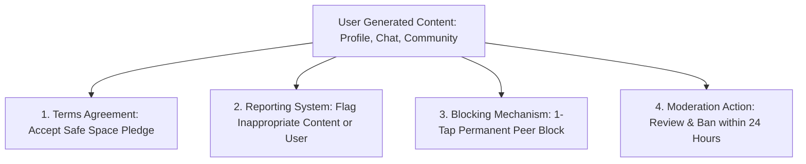

# Wehere 💜 — Data Inventory, Privacy Policy & Terms of Service Requirements

**Document Status**: Final Specification  
**Version**: 1.0.0  
**Target Applications**: Flutter Mobile Client (iOS / Android), Node.js/Prisma Backend, Admin Panel  
**Applicable Legal Frameworks**: GDPR (EU/UK), CCPA/CPRA (California), DPDP Act 2023 (India), Apple App Store Review Guidelines (1.2 UGC, 5.1 Privacy), Google Play Developer Policies (User Data, Families/Age Gating, Health Content)

---

## Executive Summary

**Wehere** is a peer-to-peer emotional wellness connection platform. Because the application handles **sensitive emotional data** (feelings, mental health struggles, mood check-ins, journal reflections, and personal chat messages), it falls under heightened regulatory scrutiny regarding data protection and intermediary liability. 

This document defines:
1. **Complete Data Audit**: Exactly what data is collected, where it is stored, how long it is retained, and who can access it.
2. **Mandatory Legal Policies**: The essential documents required for production deployment, Play Store / App Store approval, and legal protection.
3. **Drafted Core Clauses**: Ready-to-use clauses for Terms of Service, Medical & Crisis Disclaimers, Privacy Policy, and Community Guidelines.

---

## 1. Complete Data Audit: What Data Is Being Saved?

### 1.1 Backend Database (PostgreSQL via Prisma ORM)

| Category | Model / Table | Specific Fields Stored | Data Classification | Purpose & Storage Location |
| :--- | :--- | :--- | :--- | :--- |
| **User Identity & Auth** | `User` | `id` (UUID), `email`, `username`, `phone` (optional), `password` (Bcrypt hashed), `role` (`USER`/`ADMIN`), `emailVerified`, `emailVerifiedAt`, `tokenVersion` | **PII (Personally Identifiable Information)** | Account creation, authentication, password resets, session invalidation. Stored in PostgreSQL `User` table. |
| **Authentication OTPs** | `OtpRecord` | `id`, `userId`, `purpose` (`verify_email`, `reset_password`), `codeHash` (SHA-256 hashed), `expiresAt`, `attempts`, `usedAt`, `createdAt` | **Security Credential** | Multi-factor verification. Ephemeral; expires within 10–15 minutes. |
| **Public & Peer Profile** | `User` | `pseudonym`, `avatar`, `bio` (up to 500 chars), `location` (city/region string), `profession`, `lookingFor`, `images` (array of image paths), `photoVersion`, `isAnonymous` (boolean) | **User-Generated Profile Data** | Displaying discovery cards, peer profiles, and chat headers. |
| **Emotional & Support Profile** | `User` | `interests` (array of strings, max 10), `feelings` (array of strings, e.g., "Anxious", "Burnout", max 10), `supportTypes` (array of strings, e.g., "Listening Ear", max 5) | **Sensitive Personal Data (Health / Emotional State)** | Algorithmic compatibility scoring and peer matching deck. |
| **Gamification & Habits** | `User` | `xp` (integer), `level` (integer), `currentStreak` (integer), `lastLoginDate` (timestamp) | **App Usage Metrics** | Habit tracking, non-punitive streak calculation, achievement badges. |
| **Account Standing & Safety** | `User` | `isBanned` (boolean), `createdAt`, `updatedAt` | **Operational / Trust & Safety** | Moderation, ban enforcement, account lifecycle tracking. |
| **Daily Mood Check-ins** | `DailyMood` | `id`, `userId`, `mood` (e.g., "Great", "Good", "Okay", "Low", "Struggling"), `createdAt` | **Sensitive Health / Wellness Data** | User habit tracking, weekly emotional analytics graph. |
| **Personal Journaling** | `JournalEntry` | `id`, `userId`, `content` (text), `moodScore` (1–5 integer), `category` (e.g., Gratitude, Venting), `isPrivate` (boolean), `createdAt`, `updatedAt` | **Highly Sensitive Personal Data** | In-app self-reflection. When `isPrivate: true`, only visible to the user. |
| **Discovery & Swiping** | `Swipe` | `id`, `swiperId`, `swipedId`, `isRight` (boolean: connect vs pass), `createdAt` | **Interaction History** | Preventing repeated cards in the deck; detecting mutual likes. Unique constraint on `(swiperId, swipedId)`. |
| **Peer Matches** | `Match` | `id`, `userAId`, `userBId`, `status` (`pending`, `connected`, `rejected`), `matchScore` (percentage integer), `createdAt`, `updatedAt` | **Relationship Graph** | Enabling private chat sessions between mutual connections. |
| **Direct Messaging** | `Conversation`, `Message` | `id`, `conversationId`, `senderId`, `content` (text), `isRead` (boolean), `createdAt` | **Confidential Communication** | Peer-to-peer 1-on-1 support messages. Linked to specific match conversation. |
| **Community Feeds** | `CommunityPost`, `Comment`, `PostLike` | `id`, `authorId`, `topic`, `content`, `likesCount`, `createdAt`, `updatedAt` | **Public / Community UGC** | Shared support discussions and reflections in community circles. |
| **Wellness Goals** | `WellnessGoal` | `id`, `userId`, `title`, `subtitle`, `categoryColor`, `progress` (0.0 to 1.0 float), `isCompleted` (boolean), `createdAt` | **Wellness Habit Data** | Micro-goal tracking (e.g., "Drink water", "10-minute walk"). |
| **Emergency SOS Contacts** | `EmergencyContact` | `id`, `userId`, `name`, `phone`, `relationship` (optional), `createdAt` | **Sensitive Safety Data** | Quick-dial SOS trigger in distress scenarios. Visible only to author. |
| **Moderation & Reports** | `Report`, `Block` | `reporterId`, `reportedId`, `reason`, `description`, `reportedPhotoUrl`, `status` (`pending`, `reviewed`, `resolved`), `createdAt` | **Trust & Safety / Legal Compliance** | Investigation of abusive behavior, harassment, and Terms violations. |
| **Notifications** | `Notification` | `id`, `userId`, `type` (`match`, `message`, `comment`, `like`), `title`, `body`, `isRead`, `createdAt` | **System Communications** | In-app notification bell / inbox alerts. |

---

### 1.2 File & Media Storage (Server Filesystem)

| Item | Storage Path | Format & Processing | Privacy & Retention Controls |
| :--- | :--- | :--- | :--- |
| **Profile Photos** | `/var/www/wehere/backend/public/uploads/<uuid>.webp` | Re-encoded to WebP format, resized to max 1440px on long side at 80% quality via `sharp`. | **EXIF metadata stripped**: GPS coordinates, camera model, and timestamp metadata are permanently stripped on upload. Deleted from disk when photo is deleted by user. |

---

### 1.3 Mobile Client Storage (Device Local)

| Storage Layer | Technology Used | Items Stored | Security Level |
| :--- | :--- | :--- | :--- |
| **Encrypted Auth Tokens** | `flutter_secure_storage` (Android KeyStore / iOS Keychain) | `jwt_token`, `refresh_token`, `user_id` | **High**: Hardware-backed encryption. Clearable on Logout. |
| **Local Preferences & Cache** | `shared_preferences` | Onboarding completed flag, active tab index, audio/sound preferences, draft text. | **Standard**: Sandboxed within app directory. |
| **Image Cropping Cache** | `image_cropper` / `image_picker` | Temporary photo crop cache before upload. | **Temporary**: Ephemeral cache cleared by OS or on app garbage collection. |

---

### 1.4 Network & Logs Data

| Source | Stored Items | Retention Period | Purpose |
| :--- | :--- | :--- | :--- |
| **Nginx / Docker Web Logs** | Client IP address, HTTP request method, endpoint URI, response status, user agent. | 14 to 30 days (rolling) | DDoS mitigation, rate limiting, and server diagnostic logs. |
| **Socket.io WebSockets** | Socket ID mapped to active `userId` in server memory. | Session only (purged upon disconnect) | Real-time chat message delivery and online presence indicators. |

---

## 2. Mandatory Policies & Legal Documents Required

To operate legally, prevent massive liability, and pass app store reviews, Wehere **must** publish and enforce the following documents:

```
                                  [ WEHERE LEGAL SUITE ]
                                             │
         ┌───────────────────┬───────────────┴───────────────┬───────────────────┐
         ▼                   ▼                               ▼                   ▼
[ Terms of Service ]  [ Privacy Policy ]            [ Non-Clinical &     [ Community & UGC  ]
  • User contract       • Data handling rights        Crisis Disclaimer ]  Safety Guidelines
  • Age limit (18+)     • Health data consent        • NOT a medical app   • Zero tolerance
  • Prohibited acts     • Deletion / export (GDPR)   • 988/SOS protocol    • Report/block rules
```

1. **Terms of Service (ToS)**: Binding contract governing app usage, age restriction, prohibited conduct, peer boundaries, and liability limitations.
2. **Privacy Policy**: Regulatory document satisfying GDPR, CCPA/CPRA, and DPDP 2023, detailing data collection, processing lawful basis, and user privacy rights.
3. **Non-Clinical Medical & Crisis Disclaimer**: Clear statement that Wehere is **not healthcare, therapy, or emergency response**.
4. **Community Guidelines & Safe Space Pledge**: Code of conduct governing interactions, prohibiting harassment, romantic solicitations, medical advice, and hate speech.
5. **App Store User-Generated Content (UGC) Policy**: Required by Apple Guideline 1.2 and Google Play UGC policy (blocking, reporting, rapid 24h moderation turnaround).

---

## 3. Required Policy Content & Key Draft Clauses

### 3.1 Non-Clinical Medical & Crisis Disclaimer *(Critical Liability Protection)*

> [!WARNING]
> **This disclaimer must be displayed during onboarding and accessible at all times in the Settings and SOS Hub.**

#### Draft Language:
```markdown
### 1. Not Medical or Mental Health Care
WEHERE IS NOT A HEALTHCARE PROVIDER, LICENSED CLINICAL THERAPY SERVICE, OR MEDICAL CLINIC. THE SERVICES, INCLUDING OUR PEER MATCHING, MOOD TRACKING, BREATHING EXERCISES, COMMUNITY CIRCLES, AND DIRECT MESSAGING, ARE PROVIDED STRICTLY FOR PEER EMOTIONAL SUPPORT, PERSONAL MINDFULNESS, AND GENERAL WELLNESS PURPOSES ONLY. 

WEHERE DOES NOT PROVIDE PSYCHOTHERAPY, PSYCHIATRIC DIAGNOSES, CLINICAL COUNSELING, PHARMACEUTICAL RECOMMENDATIONS, OR EMERGENCY MEDICAL SERVICES. CONVERSATIONS WITH PEERS ARE NOT CONFIDENTIAL MEDICAL SESSIONS OR DOCTOR-PATIENT RELATIONSHIPS.

### 2. Not an Emergency Crisis Hotline
IF YOU ARE IN IMMEDIATE PHYSICAL DANGER, THINKING ABOUT SELF-HARM, SUICIDE, OR EXPERIENCING A MEDICAL EMERGENCY, IMMEDIATELY STOP USING THIS APP AND CONTACT LOCAL EMERGENCY AUTHORITIES OR A CERTIFIED CRISIS HELPLINE:
- United States & Canada: Call or text 988 (Suicide & Crisis Lifeline) or text "HOME" to 741741.
- India: Call 14416 (Tele-MANAS) or +91 9999 666 555 (Vandrevala Foundation).
- United Kingdom: Call 111 or 999, or text "SHOUT" to 85258.
- International: Visit https://findahelpline.com to find free, confidential crisis counseling in your country.
```

---

### 3.2 Terms of Service (ToS) — Key Required Clauses

#### Clause 1: Age Gating & Eligibility
* **Requirement**: The app deals with emotional distress and adult themes (burnout, loneliness, relationship transitions).
* **Clause Language**:
  > *"You must be at least 18 years of age (or the age of legal majority in your jurisdiction) to create an account or use Wehere. If you are under 18, you are strictly prohibited from using the platform. We do not knowingly collect personal data from minors. Any account discovered to belong to a minor will be terminated immediately."*

#### Clause 2: Peer Support Boundaries (No Clinical Advice)
* **Clause Language**:
  > *"Wehere connects peers for mutual empathy and active listening. You agree not to represent yourself as a licensed counselor, medical doctor, or clinical therapist on Wehere unless explicitly verified in an institutional capacity. You agree not to give medical advice, prescribe remedies, or advise peers to alter medications."*

#### Clause 3: Prohibited Conduct & Zero-Tolerance Harassment
* **Clause Language**:
  > *"You agree not to use Wehere to:
  >  1. Harass, stalk, intimidate, bully, or demean any user.
  >  2. Solicit romantic, sexual, or dating encounters under the guise of emotional vulnerability.
  >  3. Promote, encourage, or provide instructions for suicide or self-harm.
  >  4. Share sexually explicit images, pornographic content, or non-consensual imagery.
  >  5. Engage in hate speech targeting race, ethnicity, nationality, religion, sexual orientation, disability, or gender identity.
  >  6. Solicit money, loans, donations, or engage in commercial advertising.
  >  7. Reveal the private offline identity, telephone number, address, or employer of any peer without their express consent."*

#### Clause 4: Safe Space Pledge & Peer Agreement
* **Clause Language**:
  > *"Every user must agree to our Safe Space Pledge before connecting with peers:
  >  - I will listen without judgment.
  >  - I will respect personal boundaries and not pressure anyone for private details.
  >  - I will honor my peer's emotional state and refrain from invalidating their feelings.
  >  - I understand that Wehere moderators reserve the right to ban any account violating this pledge without prior notice."*

#### Clause 5: Limitation of Liability
* **Clause Language**:
  > *"TO THE MAXIMUM EXTENT PERMITTED BY LAW, WEHERE, ITS DIRECTORS, EMPLOYEES, AND PARTNERS SHALL NOT BE LIABLE FOR ANY INDIRECT, INCIDENTAL, SPECIAL, OR CONSEQUENTIAL DAMAGES, INCLUDING EMOTIONAL DISTRESS, LOSS OF LIFE, PHYSICAL INJURY, OR REPUTATIONAL DAMAGE ARISING OUT OF YOUR USE OF THE PLATFORM OR INTERACTIONS WITH OTHER USERS. WEHERE DOES NOT CONDUCT BACKGROUND CHECKS ON USERS AND DOES NOT GUARANTEE THE SAFETY OR TRUTHFULNESS OF ANY PEER STATEMENTS."*

---

### 3.3 Privacy Policy — Key Required Sections (GDPR / DPDP / CCPA Compliant)

#### Section 1: Explicit Consent for Sensitive Health/Emotional Data
Under **GDPR Article 9** and the **Indian DPDP Act**, processing data concerning health or emotional state requires explicit opt-in consent:
* **Consent Modal at Onboarding**:
  > *"By proceeding, you explicitly consent to Wehere processing your self-reported emotional states ('Feelings', 'Interests', 'Mood Logs') to calculate peer compatibility scores and provide wellness habit metrics. You can withdraw this consent or delete your account data at any time from Settings."*

#### Section 2: How We Use Your Data
1. **To facilitate peer connections**: Compatibility scoring based on mutual feelings and support styles.
2. **To keep the platform safe**: Automated crisis keyword interception (surfacing helplines) and reviewing reports of abuse.
3. **To strip identifying metadata**: Photo uploads are automatically stripped of EXIF GPS coordinates and encoded to WebP before public display.

#### Section 3: Data Sharing & Third Parties
* **No Sale of Personal Data**: Wehere will never sell user health, mood, or personal data to data brokers or third-party advertisers.
* **Service Providers**:
  - Cloud Infrastructure & Database Hosting (Hostinger / AWS / DigitalOcean).
  - Transactional Email Service (Nodemailer via SMTP for OTP codes).

#### Section 4: Data Retention & User Rights
* **Retention Schedule**:
  - Active Accounts: Retained while the account is active.
  - Inactive Accounts / Messages: Option to purge chat history after 30 days of inactivity.
  - OTP Verification Codes: Automatically invalidated after 10 minutes and deleted during scheduled database cleanups.
  - Deleted Accounts: Full account deletion removes all `User`, `JournalEntry`, `DailyMood`, `Message`, `Match`, and `Swipe` records (cascade deletion).
* **User Rights**:
  - **Right to Access**: Users can request a machine-readable export of their data (profile, moods, journals).
  - **Right to Erasure ('Right to be Forgotten')**: Instant self-serve account deletion inside `Profile Screen -> Privacy & Settings -> Delete Account`.
  - **Right to Rectification**: Edit bio, feelings, interests, and pseudonym directly in Profile settings.

---

### 3.4 Community Guidelines & App Store UGC Compliance

Apple App Store Guideline **1.2 (User Generated Content)** and Google Play **UGC Policy** mandate 4 specific technical mechanisms:



1. **Pre-requisite Agreement**: Mandatory checkbox during onboarding accepting Community Guidelines and Safe Space Pledge.
2. **Instant 1-Tap Block**: Users can block any peer directly from the Chat or Profile screen. Blocked peers cannot message, match, or view each other (`Block` table).
3. **In-App Report Flow**: Users can report abusive content, harassment, romantic solicitation, or offensive photos with selectable reasons (`Report` table).
4. **24-Hour Moderation Turnaround**: Admin panel (`admin-panel`) allows admins to review pending reports, inspect reported photo URLs, and ban malicious users (`isBanned: true`).

---

## 4. Implementation Checklist for Production Launch

| Item | Status | Action Required |
| :--- | :---: | :--- |
| **Database Cascade Deletions** | ✅ Configured | Verified in `schema.prisma`: Deleting a user cascades and purges `JournalEntry`, `Message`, `DailyMood`, `Match`, `Swipe`, `EmergencyContact`. |
| **EXIF Stripping on Photo Upload** | ✅ Configured | Verified in `storage.js`: Sharp auto-rotates and strips camera/GPS EXIF before saving WebP images. |
| **Bcrypt Password & SHA-256 OTP** | ✅ Configured | User passwords and OTP codes are salted and hashed; no plaintext storage. |
| **Privacy Policy Web URL** | ⚠️ Required for App Stores | Host `PRIVACY_POLICY.md` as a public web page (e.g., `https://wehere.app/privacy`) for Google Play Console and App Store Connect submissions. |
| **Terms of Service Web URL** | ⚠️ Required for App Stores | Host `TERMS_OF_SERVICE.md` as a public web page (e.g., `https://wehere.app/terms`). |
| **In-App Policy Links** | ⚠️ UI Polish | Ensure links to Privacy Policy and Terms are clickable in the Signup Screen and Profile -> Settings menu. |
| **Self-Serve Account Deletion Button** | ⚠️ App Store Guideline 5.1.1(v) | Apple requires a prominent "Delete Account" button within the app settings that executes immediate or verified account deletion. |
| **Consent Checkbox on Signup** | ⚠️ Legal Compliance | Add *"I am 18+ and agree to the Terms of Service, Privacy Policy, and Safe Space Pledge"* checkbox on the Register form. |

---

## 5. Summary Recommendation

By maintaining the **purely non-clinical peer support model** and enforcing the **medical/emergency disclaimer**, Wehere avoids classification as a regulated medical device or clinical healthcare provider under HIPAA (US) or CDSCO (India). The key legal priorities prior to store publication are:
1. Publishing public web URLs for the **Privacy Policy** and **Terms of Service**.
2. Ensuring the **18+ age gate** and **Safe Space Pledge** are accepted during registration.
3. Providing the self-serve **Delete Account** option in the user profile settings to meet Apple App Store Guideline 5.1.1(v).
