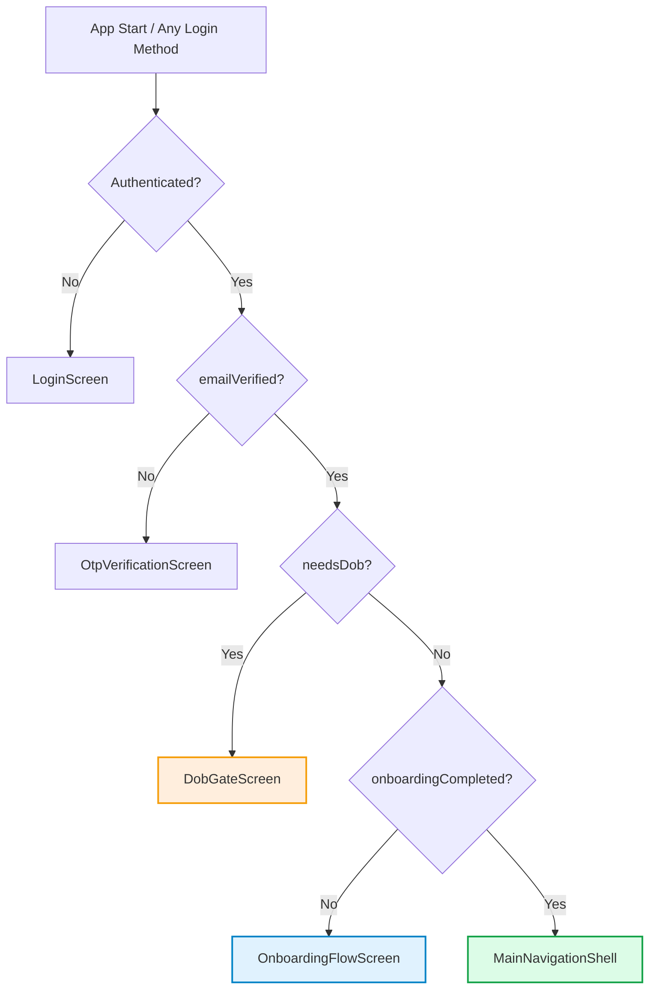
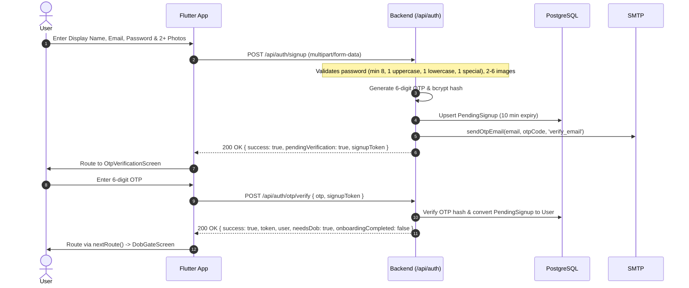

# Wehere Authentication & Account Lifecycle Architecture

This technical specification provides an end-to-end reference for all authentication, registration, unified social login (Google & Apple), age verification gating, underage protection mechanisms, and administrative access in the Wehere platform.

---

## 1. The Target Flow Contract

The entire authentication and routing lifecycle across mobile (Flutter), web, and backend conforms to a single, deterministic contract:



### Deterministic Routing Rules
1. **One Route Decision Function**: `AuthNotifier.nextRoute()` and `resolveNextRoute({ isAuthenticated, emailVerified, needsDob, onboardingCompleted })` define route transitions for the entire app. Email login, Google, Apple, OTP success, DOB confirmation, and the splash screen all use this function. No screen contains its own copy of this routing logic.
2. **Single Date of Birth Entry**: Date of birth is collected exactly once via `DobGateScreen`, as a real calendar date (day, month, year). Onboarding never asks for date of birth or age. Free-text age fabrication is forbidden.
3. **Immediate & Permanent Underage Blocking**: Anyone under 18 is immediately blocked: the server writes `underageBlockedAt = now`, wipes uploaded images, deletes avatar/bio/interests, nullifies display name, bumps `tokenVersion` (invalidates all sessions), disconnects live sockets, and responds `403 UNDERAGE`. Any subsequent login attempt (email, Google, Apple) answers `403 UNDERAGE`.

---

## 2. Core Security & Authentication Principles

1. **Stateless 7-Day JWT Sessions**:
   - Issued by `completeLogin` in `backend/src/services/authSession.js`.
   - Payload: `{ id, role, tokenVersion }` signed with `JWT_SECRET` (7-day expiry).
   - Atomic revocation across all devices on logout, password reset, or underage block via `tokenVersion` increment.
2. **Standardized Error Envelope**:
   - Every backend error adheres to `{ "error": "<UPPER_SNAKE_CODE>", "message": "<text>" }`.
   - Core codes:
     - `INVALID_CREDENTIALS` (401)
     - `TOKEN_INVALID` / `TOKEN_EXPIRED` (401)
     - `ACCOUNT_BANNED` (403)
     - `UNDERAGE` (403)
     - `AGE_REQUIRED` (403)
     - `EMAIL_NOT_VERIFIED` (403)
     - `ACCOUNT_NOT_FOUND` (404)
     - `CONFLICT` (409)
     - `VALIDATION_ERROR` (400)
     - `RATE_LIMITED` (429)
3. **Unified User Serializer (`serializeAuthUser`)**:
   - Returns `{ id, email, role, pseudonym, displayName, avatar, images, age, needsDob, onboardingCompleted, emailVerified, currentStreak }`.
   - Never exposes the raw `dateOfBirth` over the wire.
4. **Account Lifecycle & Graceful Recovery**:
   - If a returning user has a pending deletion request (`scheduledDeletionDate`), logging in automatically cancels the deletion, clears deletion timestamps, and marks `accountRestored: true`.

---

## 3. Email & Password Authentication Lifecycle

### 3.1 Registration (Two-Stage Pending Signup)


### 3.2 Login
* **Route**: `POST /api/auth/login`
* **Body**: `{ email, password }`
* **Handling**:
  - Compares password hash via `bcrypt.compare`.
  - Runs `assertAccountAllowed(user)`: blocked minor $\rightarrow$ `403 UNDERAGE`, banned user $\rightarrow$ `403 ACCOUNT_BANNED`.
  - Returns `{ success: true, token, user: serializeAuthUser(user), needsDob, onboardingCompleted }`.

### 3.3 Password Reset
* **Step 1 - Request OTP**: `POST /api/auth/otp/request` body `{ email, purpose: 'reset_password' }`. Returns `200 OK` (anti-enumeration).
* **Step 2 - Verify Code & Reset**: `POST /api/auth/reset-password` body `{ email, code, newPassword }`.
  - Validates `newPassword` against `passwordSchema`.
  - Validates OTP in `OtpRecord`.
  - Runs `assertAccountAllowed`.
  - Hashes new password, increments `tokenVersion` (invalidates all devices), and marks OTP record as used.

---

## 4. Unified Social Authentication (Google & Apple)

All social identity flows are consolidated under `backend/src/services/socialAuth.js` and three endpoints:

```
POST /api/auth/social/check      (Checks existence, pre-validates tokens & claims)
POST /api/auth/social/login      (Logs in existing accounts ONLY; never creates)
POST /api/auth/social/register   (Creates new account from verified profile + 2+ images)
```

### 4.1 Token Verification Matrix
| Provider | Verification Engine | Signature & Issuer | Audience | Nonce Verification |
| :--- | :--- | :--- | :--- | :--- |
| **Google** | `google-auth-library` (`OAuth2Client`) | Google public keys | Comma-separated `GOOGLE_CLIENT_IDS` env | Optional |
| **Apple** | `jwks-rsa` + `jsonwebtoken` | `RS256`, `https://appleid.apple.com/auth/keys` | Comma-separated `APPLE_CLIENT_IDS` env (iOS bundle ID) | Mandatory SHA-256 match: `payload.nonce === sha256(rawNonce)` |

### 4.2 Endpoint Specifications

#### A. POST `/api/auth/social/check`
* **Rate Limit**: `socialLimiter` (30 requests per 15 minutes per IP).
* **Body**: `{ provider: 'google' | 'apple', idToken: string, nonce?: string, givenName?: string, familyName?: string }`
* **Behavior**:
  - Verifies token signature and claims.
  - Queries user by provider subject (`googleId` or `appleId`), fallback by verified email.
  - If user exists and is banned $\rightarrow$ `403 ACCOUNT_BANNED`.
  - If user exists and is underage-blocked $\rightarrow$ `403 UNDERAGE`.
  - If token invalid $\rightarrow$ `401 INVALID_CREDENTIALS`.
  - Response: `{ success: true, exists: boolean, profile: { email, emailVerified, name, givenName, familyName, pictureUrl, locale } }`.
  - High-res photo upgrade: Google picture URLs trailing `=s96-c` are automatically rewritten to `=s512-c`.

#### B. POST `/api/auth/social/login`
* **Body**: `{ provider, idToken, nonce? }`
* **Behavior**:
  - Verifies token.
  - Finds account by subject or verified email.
  - If not found $\rightarrow$ `404 ACCOUNT_NOT_FOUND` (NEVER creates a phantom user).
  - Subject linking: If found by verified email without a subject, attaches `googleId` / `appleId`. If user already has a different subject for that provider $\rightarrow$ `409 CONFLICT`.
  - Completes session with `completeLogin`.

#### C. POST `/api/auth/social/register`
* **Body** (`multipart/form-data`):
  - `provider`: `'google'` | `'apple'`
  - `idToken`: Provider identity token
  - `nonce`: Client raw nonce (for Apple)
  - `pseudonym`: Chosen public display name
  - `password`: Optional un-trimmed password (if provided, validated with `passwordSchema`)
  - `phone`: Optional phone number
  - `givenName` / `familyName`: Real name hints from provider (stored privately as `realFirstName` and `legalFullName`)
  - `images`: 2 to 6 image files
* **Behavior**:
  - Re-verifies provider token.
  - Enforces account-linking rule: look up by provider subject first; if none, look up by verified email. If account already exists $\rightarrow$ `409 CONFLICT`.
  - Creates user with `emailVerified: true`, `emailVerifiedAt: now`, and invokes `completeLogin`.
  - Transitions via `nextRoute()` directly to `DobGateScreen` (skipping OTP completely).

---

## 5. Single Date of Birth Entry & Underage Enforcement

### 5.1 Enforcement Rules
1. `PUT /api/auth/onboarding`:
   - `dateOfBirth` is rejected / stripped from schema.
   - If `user.dateOfBirth == null` $\rightarrow$ `403 AGE_REQUIRED`.
   - If `user.underageBlockedAt != null` $\rightarrow$ `403 UNDERAGE`.
2. `PUT /api/users/me/dob`:
   - The **ONLY** endpoint that sets date of birth.
   - Validates format (`YYYY-MM-DD`), real calendar date, not in the future, max age 100.
   - Idempotency: If `dateOfBirth` is already set, returns `200 OK { alreadySet: true, age }`.
   - Under 18:
     - Atomic transaction: records `underageBlockedAt = now`, leaves `dateOfBirth = null`, deletes user's uploaded images, sets `images = []`, `avatar = null`, `bio = null`, `interests = []`, `displayName = null`, increments `tokenVersion`.
     - Disconnects live socket connections.
     - Responds `403 { error: 'UNDERAGE', message: 'You must be at least 18 years old to use Wehere.' }`.
3. Flutter `DobGateScreen`:
   - Input date picker (`dd/mm/yyyy`) with year selector.
   - Shows formatted confirmation dialog: *"You entered 14 Mar 2001. You can't change this later. Is it correct?"*.
   - Never evaluates age locally to log out; always calls `PUT /users/me/dob`.
   - On 403 `UNDERAGE` $\rightarrow$ triggers `AuthNotifier.handleUnderage()` which clears storage, signs out Google, resets `AppState`, and locks UI on `/auth/underage`.

---

## 6. Comprehensive API Endpoint Matrix

| Method | Endpoint | Protection | Rate Limit | Request Body | Success Response | Error Codes |
| :--- | :--- | :--- | :--- | :--- | :--- | :--- |
| `POST` | `/api/auth/signup` | Public | 15 / hr | Multipart: `email`, `password`, `pseudonym`, `phone`, `images` (2-6) | `200 OK` `{ success, pendingVerification, signupToken }` | `VALIDATION_ERROR`, `CONFLICT` |
| `POST` | `/api/auth/otp/verify` | Public | 10 / min | `{ otp, signupToken }` | `200 OK` `{ success, token, user, needsDob, onboardingCompleted }` | `VALIDATION_ERROR`, `INVALID_CREDENTIALS` |
| `POST` | `/api/auth/otp/request` | Public | 5 / hr | `{ email, purpose }` | `200 OK` `{ success, message, cooldown }` | `RATE_LIMITED`, `VALIDATION_ERROR` |
| `POST` | `/api/auth/reset-password`| Public | 10 / 15m | `{ email, code, newPassword }` | `200 OK` `{ success, message }` | `INVALID_CREDENTIALS`, `UNDERAGE`, `ACCOUNT_BANNED` |
| `POST` | `/api/auth/login` | Public | 10 / 15m | `{ email, password }` | `200 OK` `{ success, token, user, needsDob, onboardingCompleted }` | `INVALID_CREDENTIALS`, `ACCOUNT_BANNED`, `UNDERAGE` |
| `POST` | `/api/auth/social/check` | Public | 30 / 15m | `{ provider, idToken, nonce?, givenName?, familyName? }` | `200 OK` `{ success, exists, profile }` | `INVALID_CREDENTIALS`, `ACCOUNT_BANNED`, `UNDERAGE` |
| `POST` | `/api/auth/social/login` | Public | 30 / 15m | `{ provider, idToken, nonce? }` | `200 OK` `{ success, token, user, needsDob, onboardingCompleted }` | `ACCOUNT_NOT_FOUND`, `INVALID_CREDENTIALS`, `CONFLICT`, `UNDERAGE` |
| `POST` | `/api/auth/social/register`| Public | 15 / hr | Multipart: `provider`, `idToken`, `pseudonym`, `images` (2-6), etc. | `200 OK` `{ success, token, user, needsDob, onboardingCompleted }` | `CONFLICT`, `INVALID_CREDENTIALS`, `VALIDATION_ERROR` |
| `PUT` | `/api/users/me/dob` | `Bearer JWT`| 10 / hr | `{ dateOfBirth: 'YYYY-MM-DD' }` | `200 OK` `{ success, age, alreadySet? }` | `VALIDATION_ERROR`, `UNDERAGE` |
| `PUT` | `/api/auth/onboarding` | `Bearer JWT`| Standard | `{ location, profession, interests, feelings, supportTypes }` | `200 OK` `{ success, user }` | `AGE_REQUIRED`, `UNDERAGE`, `VALIDATION_ERROR` |
| `GET` | `/api/users/me` | `Bearer JWT`| Standard | None | `200 OK` User profile with `needsDob` and `onboardingCompleted` | `TOKEN_INVALID`, `TOKEN_EXPIRED`, `UNDERAGE`, `ACCOUNT_BANNED` |
