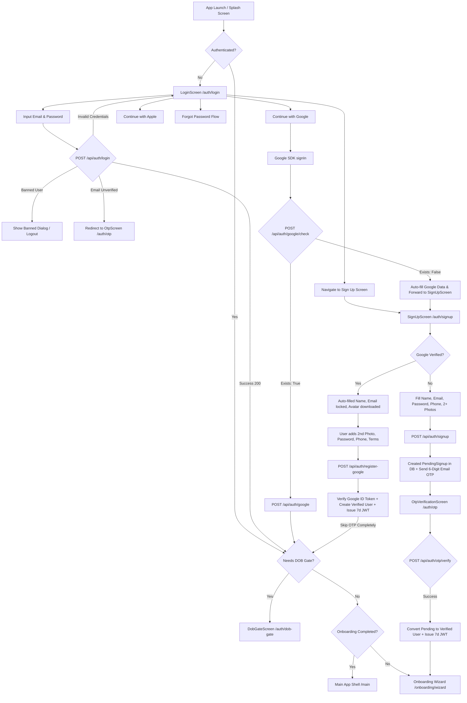
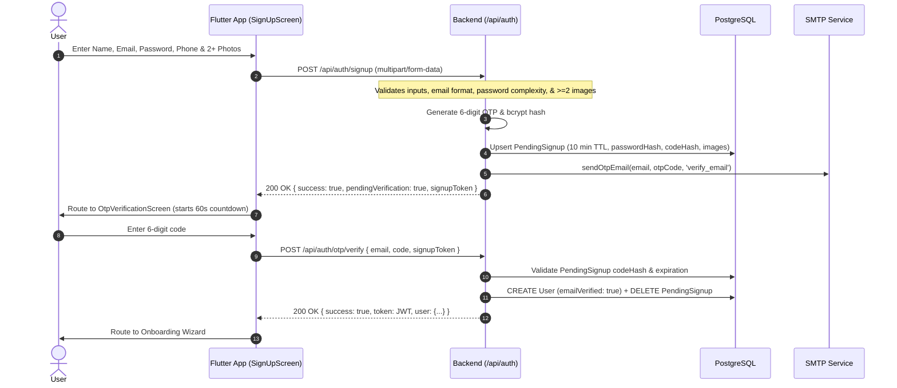
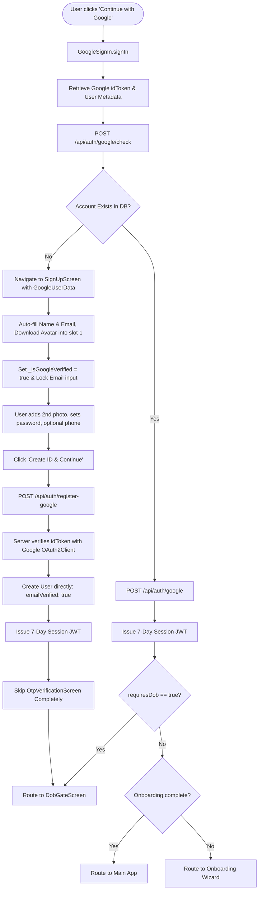
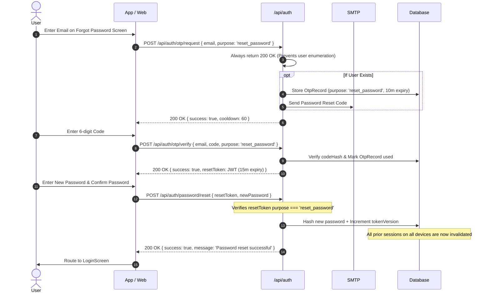
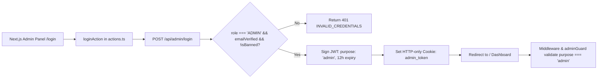

# Wehere Authentication & Account Lifecycle Architecture

This technical specification provides an end-to-end reference for all authentication, registration, social login, account creation, age gating, and administrative access mechanisms in the Wehere platform.

---

## 1. High-Level System Architecture & Flow Tree

The following diagram illustrates the complete routing and decision tree for users interacting with the authentication system:



---

## 2. Core Security & Authentication Principles

1. **Stateless JWT Tokens**:
   - User sessions are governed by 7-day HMAC-SHA256 JWT tokens containing `{ id, role, tokenVersion }`.
   - Admin sessions use separate 12-hour tokens tagged with `{ id, tokenVersion, purpose: 'admin' }`.
   - Revocation is instantaneous across all active devices via atomic increments to `user.tokenVersion`.
2. **Zero Plaintext Passwords**:
   - Passwords must meet strict entropy requirements (minimum 8 characters, at least 1 uppercase letter, 1 lowercase letter, and 1 special symbol).
   - All passwords are encrypted with `bcrypt` (cost factor 10).
3. **Production OTP Hardening**:
   - Production OTPs are strictly cryptographic 6-digit random integers generated using `crypto.randomInt(100000, 1000000)`.
   - Hardcoded test codes (e.g. `123456`) are forbidden in production; any attempt to run with `TEST_OTP_ENABLED=true` in `NODE_ENV=production` immediately triggers a fatal startup crash.
4. **Rate Limiting & Anti-Abuse**:
   - Signup: 15 requests/hour per IP.
   - Login: 10 attempts/15 minutes per IP.
   - OTP Requests: 5 requests/hour per IP with a minimum 60-second cooldown.
   - Admin Login: 5 requests/15 minutes per IP.

---

## 3. Standard Email & Password Registration Flow

### 3.1 Step-by-Step Overview
Standard registration uses a two-stage transactional pattern to ensure that unverified accounts cannot pollute the main user table or claim pseudonyms.



### 3.2 Technical Implementation Details
* **Route**: `POST /api/auth/signup`
* **Form Data**:
  - `email` (string, validated by Zod)
  - `password` (string, validated by `passwordSchema`)
  - `pseudonym` (optional string; if taken, suffixed with random 4-digit integer)
  - `phone` (optional string)
  - `images` (array of `multipart/form-data` files, minimum 2 required)
* **PendingSignup Entity (`prisma/schema.prisma`)**:
  - Stores `email`, `passwordHash`, `codeHash`, `attempts` (locked at 5), and `expiresAt` (10 minutes).
  - Stored temporary photos are automatically cleaned up if a signup is cancelled or renewed.
* **Verification Route**: `POST /api/auth/otp/verify`
  - Validates `bcrypt.compare(code, pending.codeHash)`.
  - Promotes user to persistent `User` record with `role: 'USER'`, `emailVerified: true`, and `emailVerifiedAt: new Date()`.
  - Generates 7-day session token.

---

## 4. Google Social Authentication & Registration

The Google integration supports both seamless login for existing users and instant, OTP-exempt onboarding for new users.

### 4.1 Decision Tree for Google Authentication



### 4.2 Endpoint Details

#### A. Pre-Check Endpoint: `POST /api/auth/google/check`
* **Purpose**: Determine if the Google account or email is already registered without creating orphaned records.
* **Payload**: `{ idToken: string }`
* **Backend Processing**:
  - Validates `idToken` using `googleClient.verifyIdToken({ audience: [CLIENT_ID] })`.
  - Searches database for matching `googleId` or normalized `email`.
* **Response**:
  ```json
  {
    "success": true,
    "exists": true | false,
    "email": "user@gmail.com",
    "name": "Jane Doe",
    "picture": "https://lh3.googleusercontent.com/..."
  }
  ```

#### B. Direct Social Login: `POST /api/auth/google`
* **Purpose**: Authenticate existing users.
* **Payload**: `{ idToken: string }`
* **Backend Processing**:
  - Verifies token.
  - Checks if user is banned (`isBanned`) or underage-locked (`underageBlockedAt`).
  - Auto-heals legacy accounts: links `googleId` and marks `emailVerified: true`.
  - Calculates daily login streaks (`evaluateStreak`).
  - Returns `requiresDob: !user.dateOfBirth`.

#### C. Google-Verified Registration: `POST /api/auth/register-google`
* **Purpose**: Onboard brand new Google users without requiring email OTP verification.
* **Payload** (`multipart/form-data`):
  - `idToken`: Google JWT
  - `pseudonym`: Chosen or auto-filled display name
  - `password`: Optional or user-entered password (enabling dual login mode)
  - `phone`: Optional phone number
  - `images`: 2 to 6 image files (includes downloaded Google photo + user-provided photos)
* **Execution**:
  - Re-verifies `idToken` server-side against Google's public keys.
  - Ensures at least 2 profile photos are provided.
  - Hashes user password with `bcrypt` (if provided).
  - Directly creates `User` with `emailVerified: true` and `role: 'USER'`.
  - Issues 7-day session token, skipping `PendingSignup` and `OtpRecord` entirely.

---

## 5. Apple Social Authentication Flow

* **Route**: `POST /api/auth/apple`
* **Payload**:
  ```json
  {
    "identityToken": "JWT from Apple Sign-In",
    "appleId": "Apple sub identifier",
    "email": "user@privaterelay.appleid.com",
    "givenName": "Jane",
    "familyName": "Doe"
  }
  ```
* **Processing**:
  - Decodes Apple JWT and verifies subject match.
  - Queries user by `appleId` or `email`.
  - If new user: Provisions verified account with private relay email or real email.
  - If existing user: Associates `appleId`, activates `emailVerified = true`.
  - Evaluates streaks and issues 7-day session token.

---

## 6. Password Reset Lifecycle

The password recovery workflow prevents user enumeration attacks and enforces single-use token invalidation:



---

## 7. Age Gate & Date of Birth Enforcement (`DobGateScreen`)

Wehere strictly enforces an 18+ age limit. Date of birth is self-declared once and cannot be modified by the user afterwards.

### 7.1 Backend Rules (`PUT /api/users/me/dob`)
1. **Underage Check**:
   - If user's age $< 18$:
     - Immediately writes `underageBlockedAt: new Date()` to the database.
     - Leaves `dateOfBirth: null` to avoid storing minor data.
     - Returns HTTP 403 `UNDERAGE`.
     - App immediately clears credentials and logs the user out.
2. **Idempotency**:
   - If `user.dateOfBirth != null` already:
     - Returns HTTP 200 OK `{ success: true, alreadySet: true, age, message: 'Date of birth is already set.' }`.
     - Prevents UI blocking loops when navigating through authentication gates.
3. **Valid Declaration**:
   - Parses `YYYY-MM-DD`. If age $\ge 18$, stores `dateOfBirth` and returns 200 OK.

### 7.2 Frontend Handling (`lib/screens/auth/dob_gate_screen.dart`)
* The screen checks `auth.needsDob`.
* On submit:
  - Calls `apiClient.put('/users/me/dob', data: { 'dateOfBirth': formatted })`.
  - On 200 OK (or 409 fallback):
    - Sets `auth.setNeedsDob(false)`.
    - Refreshes current user state.
    - If onboarding is completed $\rightarrow$ navigates to `AppRoutes.main`.
    - If onboarding is pending $\rightarrow$ navigates to `AppRoutes.onboarding`.

---

## 8. Admin Panel Authentication

The Admin Panel (`admin-panel/`) uses a separate, elevated authentication pipeline:



* **Backend Guard**: `adminGuard` in [backend/src/middleware/auth.js](file:///e:/Websites/Wehere/backend/src/middleware/auth.js) ensures regular user tokens (even valid 7-day tokens) cannot access `/api/admin/*` routes.
* **Session Cookie**: Stored as an HTTP-only, SameSite=Lax cookie valid for 12 hours.

---

## 9. Comprehensive API Endpoint Reference Table

| Method | Endpoint | Protection | Rate Limit | Request Body | Success Response | Error Codes |
| :--- | :--- | :--- | :--- | :--- | :--- | :--- |
| `POST` | `/api/auth/signup` | Public | 15 / hr | Multipart: `email`, `password`, `pseudonym`, `phone`, `images` (min 2) | `200 OK` `{ success, pendingVerification, signupToken }` | `VALIDATION_ERROR`, `CONFLICT` |
| `POST` | `/api/auth/otp/verify` | Public | 10 / min | `{ email, code, signupToken, purpose }` | `200 OK` `{ success, token, user }` | `INVALID_CODE`, `EXPIRED_CODE`, `MAX_ATTEMPTS` |
| `POST` | `/api/auth/otp/request` | Public | 5 / hr | `{ email, purpose, signupToken }` | `200 OK` `{ success, message, cooldown }` | `RATE_LIMITED` |
| `POST` | `/api/auth/login` | Public | 10 / 15m | `{ email, password }` | `200 OK` `{ success, token, user, requiresDob }` | `INVALID_CREDENTIALS`, `ACCOUNT_BANNED`, `EMAIL_NOT_VERIFIED` |
| `POST` | `/api/auth/google/check` | Public | - | `{ idToken }` | `200 OK` `{ success, exists, email, name, picture }` | `VALIDATION_ERROR`, `INVALID_CREDENTIALS` |
| `POST` | `/api/auth/google` | Public | - | `{ idToken }` | `200 OK` `{ success, token, user, requiresDob }` | `INVALID_CREDENTIALS`, `ACCOUNT_BANNED`, `UNDERAGE` |
| `POST` | `/api/auth/register-google`| Public | 15 / hr | Multipart: `idToken`, `pseudonym`, `password`, `phone`, `images` (min 2) | `200 OK` `{ success, token, user, requiresDob }` | `VALIDATION_ERROR`, `CONFLICT`, `INVALID_CREDENTIALS` |
| `POST` | `/api/auth/apple` | Public | - | `{ identityToken, appleId, email, givenName, familyName }` | `200 OK` `{ success, token, user, requiresDob }` | `VALIDATION_ERROR`, `INVALID_CREDENTIALS` |
| `PUT` | `/api/users/me/dob` | `Bearer JWT` | 10 / hr | `{ dateOfBirth: 'YYYY-MM-DD' }` | `200 OK` `{ success, age, alreadySet, message }` | `VALIDATION_ERROR`, `UNDERAGE` |
| `POST` | `/api/admin/login` | Public | 5 / 15m | `{ email, password }` | `200 OK` `{ success, token }` | `INVALID_CREDENTIALS` |
