# Database Schema & Entity Relationships: Wehere

The Wehere backend uses **PostgreSQL** managed through **Prisma ORM** ([backend/prisma/schema.prisma](file:///e:/Websites/Wehere/backend/prisma/schema.prisma)). This document provides an exhaustive reference of all 17 database models, their data types, default constraints, indexing strategies, foreign key cascade behaviors, and the corresponding Flutter mobile features that interact with each table.

---

## 1. Entity Relationship (ER) Mermaid Diagram

```mermaid
erDiagram
    User ||--o{ OtpRecord : "receives"
    User ||--o{ JournalEntry : "writes"
    User ||--o{ DailyMood : "logs"
    User ||--o{ WellnessGoal : "tracks"
    User ||--o{ EmergencyContact : "manages"
    User ||--o{ Notification : "receives"
    User ||--o{ CommunityPost : "authors"
    User ||--o{ Comment : "writes"
    User ||--o{ PostLike : "likes"
    User ||--o{ Swipe : "swipes (initiator/receiver)"
    User ||--o{ Match : "matched (userA/userB)"
    User ||--o{ Block : "blocks (blocker/blocked)"
    User ||--o{ Report : "reports (reporter/reported)"
    User ||--o{ Message : "sends"

    Match ||--|| Conversation : "has one"
    Conversation ||--o{ Message : "contains"
    CommunityPost ||--o{ Comment : "contains"
    CommunityPost ||--o{ PostLike : "receives"

    User {
        string id PK
        string email UK
        string handle UK
        string pseudonym
        string realFirstName
        string displayName
        enum nameDisplayPreference
        string[] images
        int xp
        int level
        int currentStreak
        datetime dateOfBirth
        datetime underageBlockedAt
        boolean emailVerified
        int tokenVersion
        datetime scheduledDeletionDate
    }

    PendingSignup {
        string id PK
        string email UK
        string phone
        string passwordHash
        string pseudonym
        string[] images
        string codeHash
        int attempts
        datetime expiresAt
        datetime createdAt
    }

    OtpRecord {
        string id PK
        string userId FK
        string purpose
        string codeHash
        datetime expiresAt
        int attempts
    }

    JournalEntry {
        string id PK
        string userId FK
        string content
        int moodScore
        string category
        boolean isPrivate
        datetime createdAt
    }

    Match {
        string id PK
        string userAId FK
        string userBId FK
        string status
        boolean userARevealed
        boolean userBRevealed
    }

    Conversation {
        string id PK
        string matchId FK,UK
        datetime createdAt
    }

    Message {
        string id PK
        string conversationId FK
        string senderId FK
        string content
        boolean isRead
        datetime createdAt
    }

    DailyMood {
        string id PK
        string userId FK
        string mood
        datetime createdAt
    }

    CommunityPost {
        string id PK
        string authorId FK
        string topic
        string content
        int likesCount
        datetime createdAt
    }

    Comment {
        string id PK
        string postId FK
        string authorId FK
        string content
        datetime createdAt
    }

    WellnessGoal {
        string id PK
        string userId FK
        string title
        float progress
        boolean isCompleted
    }

    EmergencyContact {
        string id PK
        string userId FK
        string name
        string phone
        string relationship
    }

    Swipe {
        string id PK
        string swiperId FK
        string swipedId FK
        boolean isRight
    }

    Block {
        string id PK
        string blockerId FK
        string blockedId FK
    }

    Report {
        string id PK
        string reporterId FK
        string reportedId FK
        string reason
        string status
    }

    ConfigOption {
        string id PK
        string type
        string label
        int order
    }
```

---

## 2. Exhaustive Table & Column Specifications

### 1. `User` Table ([schema.prisma:L16-L77](file:///e:/Websites/Wehere/backend/prisma/schema.prisma#L16-L77))
- **Primary Key**: `id` (`String`, `@default(uuid())`)
- **Columns**:
  - `email`: `String?`, `@unique`
  - `username`: `String?`, `@unique`
  - `phone`: `String?`, `@unique`
  - `password`: `String?` (bcrypt hash)
  - `role`: `String`, `@default("USER")` (`USER` or `ADMIN`)
  - `isAnonymous`: `Boolean`, `@default(false)`
  - `pseudonym`: `String?` (Display Alias)
  - `legalFullName`: `String?` (Optional legal name)
  - `realFirstName`: `String?` (Real verified first name revealed during handshake)
  - `displayName`: `String?`
  - `handle`: `String?`, `@unique`
  - `nameDisplayPreference`: `NameDisplayPreference` enum (`@default(DISPLAY_NAME_ONLY)`)
  - `avatar`: `String?`
  - `bio`: `String?`
  - `images`: `String[]` (PostgreSQL text array for profile photos)
  - `location`: `String?`
  - `profession`: `String?`
  - `lookingFor`: `String?`
  - `interests`: `String[]`
  - `feelings`: `String[]`
  - `supportTypes`: `String[]`
  - `photoVersion`: `Int`, `@default(0)`
  - `xp`: `Int`, `@default(0)`
  - `level`: `Int`, `@default(1)`
  - `currentStreak`: `Int`, `@default(0)`
  - `lastLoginDate`: `DateTime?`
  - `dateOfBirth`: `DateTime?` (Added in migration `20261022000000_add_date_of_birth`; required for 18+ enforcement)
  - `createdAt`: `DateTime`, `@default(now())`
  - `updatedAt`: `DateTime`, `@updatedAt`
  - `isBanned`: `Boolean`, `@default(false)`
  - `emailVerified`: `Boolean`, `@default(false)`
  - `emailVerifiedAt`: `DateTime?`
  - `tokenVersion`: `Int`, `@default(0)`
  - `scheduledDeletionDate`: `DateTime?` (Used by 60s background purge worker)
  - `deletionRequestedAt`: `DateTime?`
- **Indexes**: `@@index([role])`, `@@index([createdAt])`, `@@index([scheduledDeletionDate])`
- **Flutter Feature Consuming**: Used universally across Auth, Profile, Discovery, and Chat.

---

### 2. `OtpRecord` Table ([schema.prisma:L79-L93](file:///e:/Websites/Wehere/backend/prisma/schema.prisma#L79-L93))
- **Primary Key**: `id` (`String`, UUID)
- **Columns**:
  - `purpose`: `String` (`"verify_email"` or `"reset_password"`)
  - `codeHash`: `String` (bcrypt hash of 6-digit PIN)
  - `expiresAt`: `DateTime` (10-minute expiry)
  - `attempts`: `Int`, `@default(0)`
  - `usedAt`: `DateTime?`
  - `createdAt`: `DateTime`, `@default(now())`
  - `userId`: `String` (Foreign Key -> `User.id`, `onDelete: Cascade`)
- **Indexes**: `@@index([userId])`, `@@index([purpose])`
- **Flutter Feature Consuming**: `SignUpScreen`, `OtpVerificationScreen`, `ResetPasswordScreen`.

---

### 3. `JournalEntry` Table ([schema.prisma:L95-L109](file:///e:/Websites/Wehere/backend/prisma/schema.prisma#L95-L109))
- **Primary Key**: `id` (`String`, UUID)
- **Columns**:
  - `content`: `String`
  - `moodScore`: `Int`, `@default(3)` (1 to 5)
  - `category`: `String?` (General, Gratitude, Reflection, Dreams)
  - `isPrivate`: `Boolean`, `@default(true)`
  - `createdAt`: `DateTime`, `@default(now())`
  - `updatedAt`: `DateTime`, `@updatedAt`
  - `userId`: `String` (Foreign Key -> `User.id`, `onDelete: Cascade`)
- **Indexes**: `@@index([userId])`, `@@index([createdAt])`
- **Flutter Feature Consuming**: `JournalHomeScreen`, `NewJournalScreen`, `JournalSuccessScreen`.

---

### 4. `Match` Table ([schema.prisma:L111-L131](file:///e:/Websites/Wehere/backend/prisma/schema.prisma#L111-L131))
- **Primary Key**: `id` (`String`, UUID)
- **Columns**:
  - `status`: `String`, `@default("pending")` (`pending`, `connected`, `rejected`)
  - `matchScore`: `Int`, `@default(0)`
  - `userARevealed`: `Boolean`, `@default(false)`
  - `userBRevealed`: `Boolean`, `@default(false)`
  - `createdAt`: `DateTime`, `@default(now())`
  - `updatedAt`: `DateTime`, `@updatedAt`
  - `userAId`: `String` (Foreign Key -> `User.id`, `onDelete: Cascade`)
  - `userBId`: `String` (Foreign Key -> `User.id`, `onDelete: Cascade`)
- **Indexes**: `@@index([userAId])`, `@@index([userBId])`, `@@index([status])`
- **Flutter Feature Consuming**: `DiscoverSwipeScreen`, `MatchCelebrationDialog`, `ChatConversationScreen` (Mutual Name Disclosure Handshake).

---

### 5. `Conversation` Table ([schema.prisma:L133-L142](file:///e:/Websites/Wehere/backend/prisma/schema.prisma#L133-L142))
- **Primary Key**: `id` (`String`, UUID)
- **Columns**:
  - `createdAt`: `DateTime`, `@default(now())`
  - `updatedAt`: `DateTime`, `@updatedAt`
  - `matchId`: `String`, `@unique` (Foreign Key -> `Match.id`, `onDelete: Cascade`)
- **Relations**: Has many `Message` records.
- **Flutter Feature Consuming**: `ChatListScreen`, `ChatConversationScreen`.

---

### 6. `Message` Table ([schema.prisma:L144-L155](file:///e:/Websites/Wehere/backend/prisma/schema.prisma#L144-L155))
- **Primary Key**: `id` (`String`, UUID)
- **Columns**:
  - `content`: `String`
  - `createdAt`: `DateTime`, `@default(now())`
  - `isRead`: `Boolean`, `@default(false)`
  - `conversationId`: `String` (Foreign Key -> `Conversation.id`, `onDelete: Cascade`)
  - `senderId`: `String` (Foreign Key -> `User.id`, `onDelete: Cascade`)
- **Flutter Feature Consuming**: `ChatBubble`, `ChatConversationScreen`, `Socket.IO send_message`.

---

### 7. `DailyMood` Table ([schema.prisma:L157-L167](file:///e:/Websites/Wehere/backend/prisma/schema.prisma#L157-L167))
- **Primary Key**: `id` (`String`, UUID)
- **Columns**:
  - `mood`: `String` (`"Great"`, `"Good"`, `"Okay"`, `"Low"`, `"Struggling"`)
  - `createdAt`: `DateTime`, `@default(now())`
  - `userId`: `String` (Foreign Key -> `User.id`, `onDelete: Cascade`)
- **Indexes**: `@@index([userId])`, `@@index([createdAt])`
- **Flutter Feature Consuming**: `HomeScreen` (Mood check-in card and weekly streak dots).

---

### 8. `CommunityPost`, `Comment` & `PostLike` Tables ([schema.prisma:L169-L193](file:///e:/Websites/Wehere/backend/prisma/schema.prisma#L169-L193), [L277-L288](file:///e:/Websites/Wehere/backend/prisma/schema.prisma#L277-L288))
- **`CommunityPost`**:
  - `topic`: `String`
  - `content`: `String`
  - `likesCount`: `Int`, `@default(0)`
  - `authorId`: `String` (Foreign Key -> `User.id`, `onDelete: Cascade`)
- **`Comment`**:
  - `content`: `String`
  - `postId`: `String` (Foreign Key -> `CommunityPost.id`, `onDelete: Cascade`)
  - `authorId`: `String` (Foreign Key -> `User.id`, `onDelete: Cascade`)
- **`PostLike`**:
  - `postId`: `String`, `userId`: `String` (Composite unique index: `@@unique([postId, userId])`)
- **Flutter Feature Consuming**: `CommunityScreen`.

---

### 9. `WellnessGoal` Table ([schema.prisma:L195-L206](file:///e:/Websites/Wehere/backend/prisma/schema.prisma#L195-L206))
- **Primary Key**: `id` (`String`, UUID)
- **Columns**:
  - `title`: `String`
  - `subtitle`: `String?`
  - `categoryColor`: `String`, `@default("0xFF22C55E")`
  - `progress`: `Float`, `@default(0.0)`
  - `isCompleted`: `Boolean`, `@default(false)`
  - `userId`: `String` (Foreign Key -> `User.id`, `onDelete: Cascade`)
- **Flutter Feature Consuming**: `ProgressDashboardScreen`.

---

### 10. `EmergencyContact` Table ([schema.prisma:L208-L217](file:///e:/Websites/Wehere/backend/prisma/schema.prisma#L208-L217))
- **Primary Key**: `id` (`String`, UUID)
- **Columns**:
  - `name`: `String`
  - `phone`: `String`
  - `relationship`: `String?`
  - `userId`: `String` (Foreign Key -> `User.id`, `onDelete: Cascade`)
- **Flutter Feature Consuming**: `SosHelpScreen` (Personal emergency contacts manager).

---

### 11. `Swipe` Table ([schema.prisma:L219-L233](file:///e:/Websites/Wehere/backend/prisma/schema.prisma#L219-L233))
- **Primary Key**: `id` (`String`, UUID)
- **Columns**:
  - `isRight`: `Boolean` (`true` for connect, `false` for pass)
  - `swiperId`: `String` (Foreign Key -> `User.id`, `onDelete: Cascade`)
  - `swipedId`: `String` (Foreign Key -> `User.id`, `onDelete: Cascade`)
- **Indexes**: `@@unique([swiperId, swipedId])`, `@@index([swiperId])`, `@@index([swipedId])`
- **Flutter Feature Consuming**: `DiscoverSwipeScreen` (Ensures users are not shown cards they previously swiped).

---

### 12. `Notification` Table ([schema.prisma:L235-L247](file:///e:/Websites/Wehere/backend/prisma/schema.prisma#L235-L247))
- **Primary Key**: `id` (`String`, UUID)
- **Columns**:
  - `type`: `String` (`"match"`, `"message"`, `"comment"`, `"like"`)
  - `title`: `String`
  - `body`: `String`
  - `isRead`: `Boolean`, `@default(false)`
  - `userId`: `String` (Foreign Key -> `User.id`, `onDelete: Cascade`)
- **Indexes**: `@@index([userId])`
- **Flutter Feature Consuming**: `ProgressDashboardScreen` notifications sheet, bottom bar unread badges.

---

### 13. `Block` & `Report` Tables ([schema.prisma:L249-L275](file:///e:/Websites/Wehere/backend/prisma/schema.prisma#L249-L275))
- **`Block`**:
  - `blockerId`: `String`, `blockedId`: `String` (`@@unique([blockerId, blockedId])`)
- **`Report`**:
  - `reason`: `String`, `description`: `String?`, `reportedPhotoUrl`: `String?`
  - `status`: `String`, `@default("pending")`
  - `reporterId`: `String`, `reportedId`: `String`
- **Flutter Feature Consuming**: `ProfileDetailSheet`, Chat Safety options menu, Admin moderation queue.

---

### 14. `ConfigOption` Table ([schema.prisma:L290-L298](file:///e:/Websites/Wehere/backend/prisma/schema.prisma#L290-L298))
- **Primary Key**: `id` (`String`, UUID)
- **Columns**:
  - `type`: `String` (`"INTEREST"`, `"FEELING"`, `"SUPPORT_TYPE"`)
  - `label`: `String`
  - `order`: `Int`, `@default(0)`
- **Indexes**: `@@index([type])`
- **Flutter Feature Consuming**: `OnboardingFlowScreen`, `EditProfileScreen`.

---

### 15. `PendingSignup` Table ([schema.prisma:L300-L315](file:///e:/Websites/Wehere/backend/prisma/schema.prisma#L300-L315))
- **Primary Key**: `id` (`String`, UUID)
- **Columns**:
  - `email`: `String` (Unique)
  - `phone`: `String?`
  - `passwordHash`: `String`
  - `pseudonym`: `String`
  - `images`: `String[]`
  - `codeHash`: `String`
  - `attempts`: `Int`, `@default(0)`
  - `expiresAt`: `DateTime`
  - `createdAt`: `DateTime`, `@default(now())`
- **Indexes**: `@@index([expiresAt])`
- **Flutter Feature Consuming**: `SignUpScreen`, `OtpVerificationScreen`. Holds registration state securely server-side so credentials and images are never embedded in client tokens. Expired rows and images are automatically purged by a 15-minute background worker.
