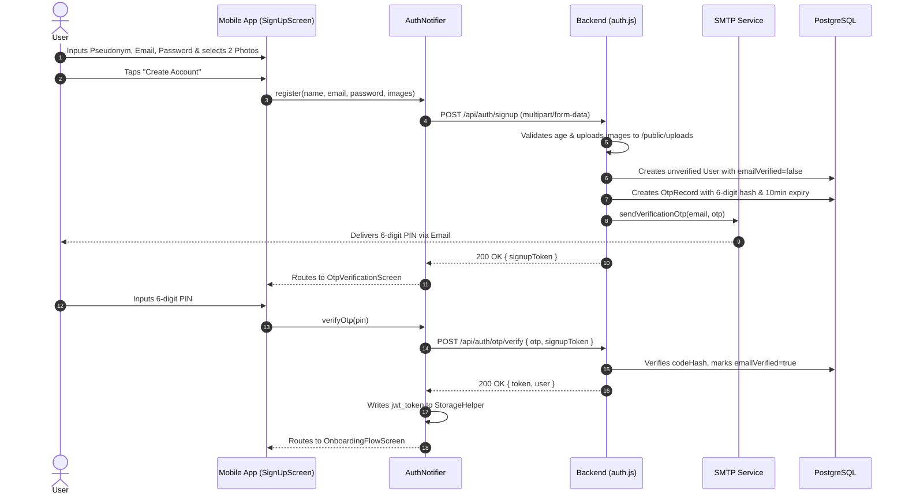
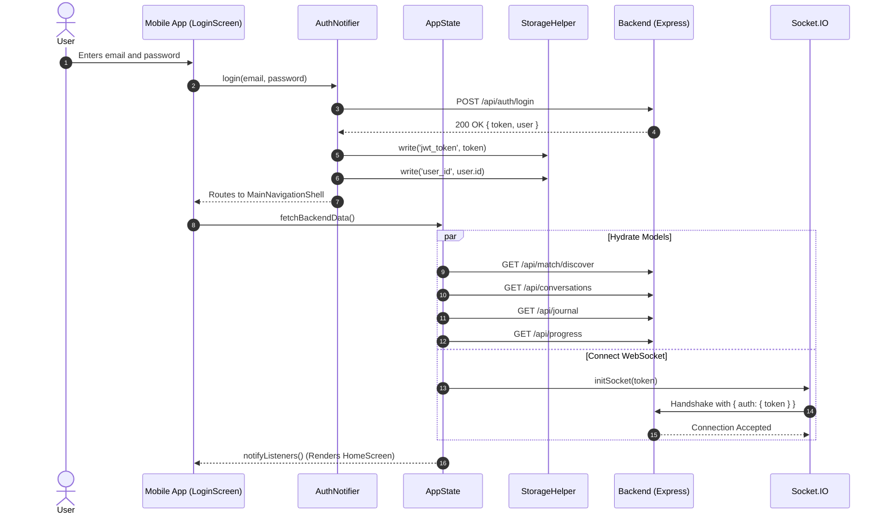
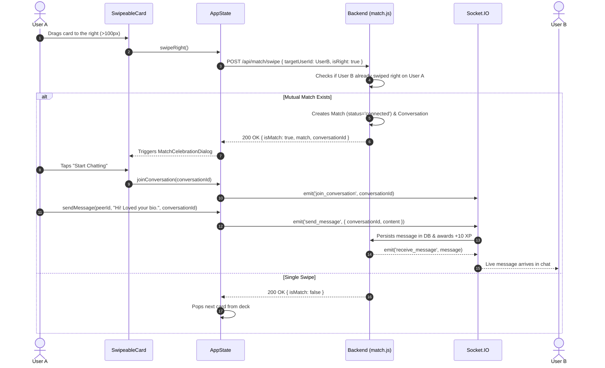
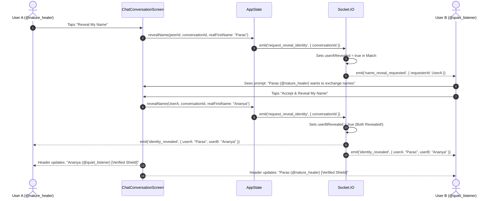
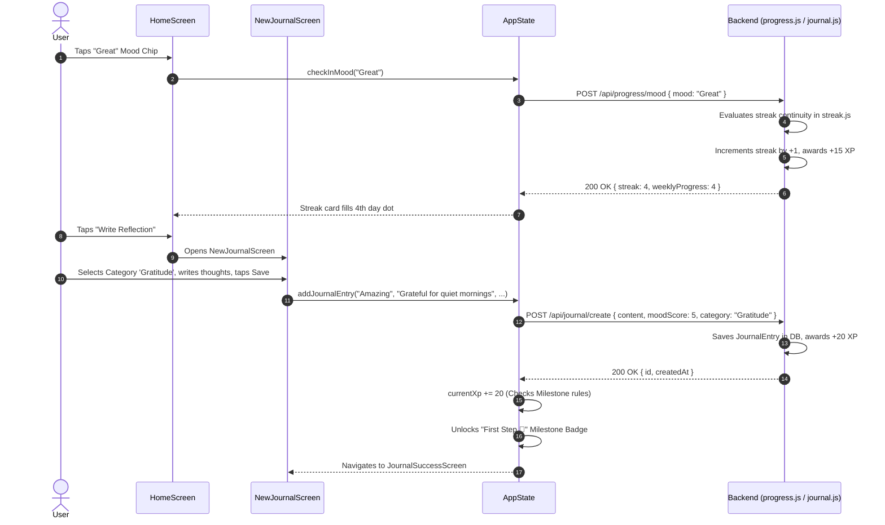

# Data & API Layer Architecture: Wehere

## 1. HTTP Networking Client Architecture

The networking foundation is built on **`Dio` (v5.11.1)** encapsulated inside [api_client.dart](file:///e:/Websites/Wehere/lib/core/network/api_client.dart).

### Base Configuration
- **Base URL**: `http://200.97.165.22:4000/api` (Default production VPS IP address). Overridable at compile time using `--dart-define=API_URL=...` ([api_client.dart](file:///e:/Websites/Wehere/lib/core/network/api_client.dart#L15)).
- **Connect Timeout**: `10 seconds` ([api_client.dart](file:///e:/Websites/Wehere/lib/core/network/api_client.dart#L16)).
- **Receive Timeout**: `10 seconds` ([api_client.dart](file:///e:/Websites/Wehere/lib/core/network/api_client.dart#L17)).
- **Default Headers**: `{'Content-Type': 'application/json'}` ([api_client.dart](file:///e:/Websites/Wehere/lib/core/network/api_client.dart#L19)).

### Interceptors & Event Bus
The `ApiClient` registers an `InterceptorsWrapper` that executes on every request and response:
1. **`onRequest` Interceptor** ([api_client.dart](file:///e:/Websites/Wehere/lib/core/network/api_client.dart#L24-L30)):
   - Asynchronously queries `StorageHelper.read(key: 'jwt_token')`.
   - If present, injects the header `Authorization: Bearer <token>`.
2. **`onError` Interceptor** ([api_client.dart](file:///e:/Websites/Wehere/lib/core/network/api_client.dart#L31-L45)):
   - **HTTP 401 Unauthorized**: Automatically purges the cached `jwt_token` from hardware storage and broadcasts `AuthEvent.loggedOut` across `authEventStream`.
   - **HTTP 403 Forbidden**:
     - If `response.data['error'] == 'EMAIL_NOT_VERIFIED'`: Broadcasts `AuthEvent.emailNotVerified`.
     - Otherwise: Purges `jwt_token` and broadcasts `AuthEvent.loggedOut`.

---

## 2. Exhaustive API Endpoint Catalog

| HTTP Method | API Endpoint Path | Request Payload / Params | Response Model / Payload | Client Function / Caller | File Path |
| :--- | :--- | :--- | :--- | :--- | :--- |
| `POST` | `/api/auth/signup` | `FormData` (`email`, `password`, `pseudonym`, `phone`, `images: MultipartFile[]`) | `{ signupToken: String }` | `AuthNotifier.register()` | [auth_notifier.dart](file:///e:/Websites/Wehere/lib/state/auth_notifier.dart#L170) |
| `POST` | `/api/auth/login` | `{ email, password }` | `{ token: String, user: User }` | `AuthNotifier.login()` | [auth_notifier.dart](file:///e:/Websites/Wehere/lib/state/auth_notifier.dart#L89) |
| `POST` | `/api/auth/otp/verify`| `{ otp: String, signupToken?: String }` | `{ success: bool, token: String, user: User }` | `AuthNotifier.verifyOtp()` | [auth_notifier.dart](file:///e:/Websites/Wehere/lib/state/auth_notifier.dart#L229) |
| `POST` | `/api/auth/otp/request`| `{ email: String, purpose: String }` | `{ success: bool, email: String }` | `_sendPasswordResetOtp()` | [login_screen.dart](file:///e:/Websites/Wehere/lib/screens/auth/login_screen.dart#L40) |
| `POST` | `/api/auth/reset-password`| `{ email, otp, newPassword }` | `{ success: bool, message: String }` | `_handleReset()` | [reset_password_screen.dart](file:///e:/Websites/Wehere/lib/screens/auth/reset_password_screen.dart#L51) |
| `PUT` | `/api/auth/onboarding`| `{ name, displayName, realFirstName, handle, nameDisplayPreference, location, profession, interests, feelings, supportTypes, isAnonymous }` | `{ success: bool, user: User }` | `AuthNotifier.completeOnboarding()` | [auth_notifier.dart](file:///e:/Websites/Wehere/lib/state/auth_notifier.dart#L298) |
| `POST` | `/api/auth/change-password`| `{ currentPassword, newPassword }` | `{ success: bool, message: String }` | `AppState.changePassword()` | [app_state.dart](file:///e:/Websites/Wehere/lib/state/app_state.dart#L1645) |
| `GET` | `/api/users/me` | None (`Bearer Token`) | Full user object (`id`, `email`, `pseudonym`, `realFirstName`, `images`, `interests`, etc.) | `AuthNotifier.initializeSession()`, `AppState.fetchCurrentUser()` | [auth_notifier.dart](file:///e:/Websites/Wehere/lib/state/auth_notifier.dart#L68), [app_state.dart](file:///e:/Websites/Wehere/lib/state/app_state.dart#L70) |
| `PUT` | `/api/users/me` | `{ bio?, pseudonym?, location?, profession?, nameDisplayPreference?, isAnonymous? }` | `{ user: User }` | `AppState.updateNameDisplayPreference()`, `AppState.setAnonymity()`, `_saveProfile()` | [app_state.dart](file:///e:/Websites/Wehere/lib/state/app_state.dart#L1255), [edit_profile_screen.dart](file:///e:/Websites/Wehere/lib/screens/profile/edit_profile_screen.dart#L365) |
| `POST` | `/api/users/me/photos`| `FormData` (`photo: MultipartFile`) | `{ success: bool, images: String[] }` | `PhotoGrid._pickAndCropImage()` | [photo_grid.dart](file:///e:/Websites/Wehere/lib/widgets/profile/photo_grid.dart#L141) |
| `DELETE` | `/api/users/me/photos`| `{ photoUrl: String }` | `{ success: bool, images: String[] }` | `PhotoGrid._deletePhoto()` | [photo_grid.dart](file:///e:/Websites/Wehere/lib/widgets/profile/photo_grid.dart#L201) |
| `PUT` | `/api/users/me/photos/order`| `{ images: String[] }` | `{ success: bool, images: String[] }` | `PhotoGrid._reorderPhotos()` | [photo_grid.dart](file:///e:/Websites/Wehere/lib/widgets/profile/photo_grid.dart#L240) |
| `DELETE` | `/api/users/me` | None | `{ message: String }` (Schedules deletion in 7 days) | `AppState.deleteAccount()` | [app_state.dart](file:///e:/Websites/Wehere/lib/state/app_state.dart#L1657) |
| `POST` | `/api/users/:id/block`| None | `{ success: bool }` | `AppState.reportAndBlockPeer()` | [app_state.dart](file:///e:/Websites/Wehere/lib/state/app_state.dart#L1155) |
| `POST` | `/api/users/:id/report`| `{ reason: String, description?: String }` | `{ success: bool }` | `AppState.reportAndBlockPeer()` | [app_state.dart](file:///e:/Websites/Wehere/lib/state/app_state.dart#L1158) |
| `GET` | `/api/config/options` | None | `{ options: { interests, feelings, supportTypes }, limits: ConfigLimits }` | `AppState.fetchConfigOptions()` | [app_state.dart](file:///e:/Websites/Wehere/lib/state/app_state.dart#L134) |
| `GET` | `/api/match/discover` | Query params (`filter?: String`) | `MatchCard[]` | `AppState.fetchBackendData()` | [app_state.dart](file:///e:/Websites/Wehere/lib/state/app_state.dart#L625) |
| `POST` | `/api/match/swipe` | `{ targetUserId: String, isRight: bool }` | `{ isMatch: bool, match?: Match, conversationId?: String }` | `AppState.swipeRight()`, `AppState.swipeLeft()` | [app_state.dart](file:///e:/Websites/Wehere/lib/state/app_state.dart#L905), [app_state.dart](file:///e:/Websites/Wehere/lib/state/app_state.dart#L924) |
| `GET` | `/api/conversations` | None | `Conversation[]` with last message and peer details | `AppState.fetchBackendData()` | [app_state.dart](file:///e:/Websites/Wehere/lib/state/app_state.dart#L650) |
| `GET` | `/api/conversations/:id/messages`| None | `Message[]` | `AppState.fetchBackendData()` | [app_state.dart](file:///e:/Websites/Wehere/lib/state/app_state.dart#L675) |
| `GET` | `/api/conversations/:id/disclosure`| None | `{ isMutuallyRevealed, myRevealed, peerRevealed, peerFirstName }` | `AppState.fetchConversationDisclosure()` | [app_state.dart](file:///e:/Websites/Wehere/lib/state/app_state.dart#L1175) |
| `POST` | `/api/conversations/:id/reveal-name`| `{ realFirstName?: String }` | `{ success: bool, isMutuallyRevealed: bool }` | `AppState.revealName()` | [app_state.dart](file:///e:/Websites/Wehere/lib/state/app_state.dart#L1210) |
| `POST` | `/api/conversations/:id/decline-reveal`| None | `{ success: bool }` | `AppState.declineReveal()` | [app_state.dart](file:///e:/Websites/Wehere/lib/state/app_state.dart#L1245) |
| `GET` | `/api/journal` | None | `JournalEntry[]` | `AppState.fetchBackendData()` | [app_state.dart](file:///e:/Websites/Wehere/lib/state/app_state.dart#L710) |
| `POST` | `/api/journal/create` | `{ content, moodScore, category, isPrivate }` | `JournalEntry` | `AppState.addJournalEntry()` | [app_state.dart](file:///e:/Websites/Wehere/lib/state/app_state.dart#L1325) |
| `PUT` | `/api/journal/:id` | `{ content, moodScore, category, isPrivate }` | `JournalEntry` | `AppState.updateJournalEntry()` | [app_state.dart](file:///e:/Websites/Wehere/lib/state/app_state.dart#L1385) |
| `DELETE` | `/api/journal/:id` | None | `{ success: bool }` | `AppState.deleteJournalEntry()` | [app_state.dart](file:///e:/Websites/Wehere/lib/state/app_state.dart#L1414) |
| `GET` | `/api/progress` | None | `{ currentStreak, weeklyProgress, xp, level }` | `AppState.fetchBackendData()` | [app_state.dart](file:///e:/Websites/Wehere/lib/state/app_state.dart#L740) |
| `GET` | `/api/progress/mood/today`| None | `{ mood: String }` | `AppState.fetchBackendData()` | [app_state.dart](file:///e:/Websites/Wehere/lib/state/app_state.dart#L765) |
| `POST` | `/api/progress/mood` | `{ mood: String }` | `{ success: bool, streak: int }` | `AppState.checkInMood()` | [app_state.dart](file:///e:/Websites/Wehere/lib/state/app_state.dart#L1425) |
| `GET` | `/api/goals` | None | `WellnessGoal[]` | `AppState.fetchBackendData()` | [app_state.dart](file:///e:/Websites/Wehere/lib/state/app_state.dart#L785) |
| `POST` | `/api/goals` | `{ title, subtitle, categoryColor }` | `WellnessGoal` | `AppState.addGoal()` | [app_state.dart](file:///e:/Websites/Wehere/lib/state/app_state.dart#L1468) |
| `PUT` | `/api/goals/:id/toggle`| None | `WellnessGoal` | `AppState.toggleGoal()` | [app_state.dart](file:///e:/Websites/Wehere/lib/state/app_state.dart#L1440) |
| `GET` | `/api/community` | None | `CommunityPost[]` | `AppState.fetchBackendData()` | [app_state.dart](file:///e:/Websites/Wehere/lib/state/app_state.dart#L810) |
| `POST` | `/api/community` | `{ topic, content }` | `CommunityPost` | `AppState.addCommunityPost()` | [app_state.dart](file:///e:/Websites/Wehere/lib/state/app_state.dart#L1522) |
| `POST` | `/api/community/:id/like`| None | `{ success: bool, likesCount: int }` | `AppState.togglePostLike()` | [app_state.dart](file:///e:/Websites/Wehere/lib/state/app_state.dart#L1498) |
| `GET` | `/api/community/:id/comments`| None | `CommunityComment[]` | `AppState.fetchBackendData()` | [app_state.dart](file:///e:/Websites/Wehere/lib/state/app_state.dart#L835) |
| `POST` | `/api/community/:id/comments`| `{ commentText: String }` | `CommunityComment` | `AppState.addComment()` | [app_state.dart](file:///e:/Websites/Wehere/lib/state/app_state.dart#L1575) |
| `GET` | `/api/sos/contacts` | None | `EmergencyContact[]` | `AppState.fetchBackendData()` | [app_state.dart](file:///e:/Websites/Wehere/lib/state/app_state.dart#L855) |
| `POST` | `/api/sos/contacts` | `{ name, phone, relationship }` | `EmergencyContact` | `AppState.addEmergencyContact()` | [app_state.dart](file:///e:/Websites/Wehere/lib/state/app_state.dart#L1602) |
| `DELETE` | `/api/sos/contacts/:id`| None | `{ success: bool }` | `AppState.removeEmergencyContact()` | [app_state.dart](file:///e:/Websites/Wehere/lib/state/app_state.dart#L1620) |
| `GET` | `/api/notifications` | None | `UserNotification[]` | `AppState.fetchBackendData()` | [app_state.dart](file:///e:/Websites/Wehere/lib/state/app_state.dart#L875) |
| `PUT` | `/api/notifications/read-all`| None | `{ success: bool }` | `AppState.markNotificationsRead()` | [app_state.dart](file:///e:/Websites/Wehere/lib/state/app_state.dart#L1780) |

---

## 3. Local Storage & Serialization Strategy

### Secure Storage (`flutter_secure_storage`)
Used exclusively for sensitive credentials:
- `'jwt_token'`: Raw JWT session token.
- `'user_id'`: Unique user identifier UUID.
- `'user_email'`: Verified user email.
- `'onboarding_completed'`: Flag indicating whether user completed the wizard.
- `'has_seen_walkthrough'`: Flag indicating whether introduction slides were viewed.
- `'user_age'`: Cache of user age (persisted securely to prevent resetting).

### SharedPreferences Fallback & Cache
Used when `FlutterSecureStorage` encounters a `PlatformException` (notably on unsigned iOS Simulator Keychain environments):
- `'jwt_token'`, `'user_id'`, `'user_email'` (Mirror fallback).
- `'user_age'`: Integer age storage.
- `'user_dob'`: Cached Date of Birth string (`DD / MM / YYYY`).
- `'persisted_milestone_keys'`: String list of unlocked badge IDs.

---

## 4. Third-Party Services
1. **Google Fonts Runtime Delivery**:
   - `google_fonts` fetches Newsreader serif and Plus Jakarta Sans font binaries over HTTPS on first launch.
2. **Socket.IO Server (WebSockets)**:
   - Hosted directly on the Express server instance (`ws://200.97.165.22:4000/socket.io/`).
   - Uses JWT handshake authorization.
3. **Email Delivery (Nodemailer / SMTP)**:
   - Configured in [backend/src/services/email.js](file:///e:/Websites/Wehere/backend/src/services/email.js) for 6-digit OTP delivery.
4. **Firebase / Push Services**:
   - **Currently Missing**: Firebase Cloud Messaging (FCM) and Apple APNs are **not integrated** in the Flutter app or backend. Notifications are handled via in-app polling (`GET /api/notifications`).

---

## 5. Mermaid Sequence Diagrams (Top 5 Flows)

### Flow 1: User Registration, Multipart Image Upload & OTP Verification

### Flow 2: User Login & Session Hydration

### Flow 3: Discovery Swiping, Match Creation & Socket Chat

### Flow 4: Progressive Mutual Name Disclosure Handshake

### Flow 5: Daily Mood Check-In, Journal Reflection & XP Gamification

