# Dependency Map & Structural Coupling: Wehere

## 1. Architectural Layer Hierarchy & Dependency Rules

The Wehere Flutter application is structured in six functional layers:

```text
[ Presentation Screens (lib/screens/) ]
                 |
                 v
[ Presentation Widgets (lib/widgets/) ]
                 |
                 v
[ State Management Layer (lib/state/) ]
                 |
                 v
[ Domain & Data Models (lib/models/) ]
                 |
                 v
[ Core Infrastructure Layer (lib/core/) ]
```

### Layer Dependency Rules
1. **Core Layer** (`lib/core/`):
   - Foundation leaf modules (`AppColors`, `AppTextStyles`, `StorageHelper`, `IndianLocations`).
   - Must never import presentation screens or state holders.
   - Exception: [app_router.dart](file:///e:/Websites/Wehere/lib/core/routing/app_router.dart) acts as the application's top-level composition root and imports screens and `AuthNotifier`.
2. **Models Layer** (`lib/models/`):
   - Pure Dart entity definitions. Independent of Flutter rendering (except `Color` tokens in `community_post.dart`).
   - [match_card.dart](file:///e:/Websites/Wehere/lib/models/match_card.dart) imports [user_profile.dart](file:///e:/Websites/Wehere/lib/models/user_profile.dart).
3. **State Layer** (`lib/state/`):
   - Imports Models, `StorageHelper`, `ApiClient`, and `AppConstants`.
   - Must never import presentation screens or widgets.
4. **Widgets & Screens Layers** (`lib/widgets/`, `lib/screens/`):
   - Import Models, Theme, and State holders via `Provider.of` or `context.watch()`.

---

## 2. Mermaid Layer Dependency Diagram

```mermaid
graph TD
    subgraph Root [Application Root]
        Main[main.dart]
    end

    subgraph Core [Core Infrastructure]
        AppRouter[core/routing/app_router.dart]
        AppRoutes[core/routing/app_routes.dart]
        ApiClient[core/network/api_client.dart]
        StorageHelper[core/utils/storage_helper.dart]
        AppTheme[core/theme/app_theme.dart]
        AppColors[core/theme/app_colors.dart]
        AppTextStyles[core/theme/app_text_styles.dart]
        AppConstants[core/constants/app_constants.dart]
        IndianLocations[core/constants/indian_locations.dart]
        UiUtils[core/utils/ui_utils.dart]
    end

    subgraph State [State Management Layer]
        AuthNotifier[state/auth_notifier.dart]
        AppState[state/app_state.dart]
    end

    subgraph Models [Domain & Data Models]
        UserProfile[models/user_profile.dart]
        MatchCard[models/match_card.dart]
        ChatMessage[models/chat_message.dart]
        JournalEntry[models/journal_entry.dart]
        CommunityPost[models/community_post.dart]
        EmergencyContact[models/emergency_contact.dart]
        Milestone[models/milestone.dart]
        UserNotification[models/notification.dart]
        ConfigOptions[models/config_options.dart]
    end

    subgraph ShellAndTabs [Main Shell & Embedded Tabs]
        Shell[screens/main_navigation_shell.dart]
        HomeScreen[screens/home/home_screen.dart]
        DiscoverScreen[screens/discover/discover_swipe_screen.dart]
        JournalScreen[screens/journal/journal_home_screen.dart]
        ChatListScreen[screens/chat/chat_list_screen.dart]
        ProfileScreen[screens/profile/profile_screen.dart]
    end

    subgraph ModalAndSubScreens [Dedicated Feature Screens]
        AuthScreens[screens/auth/*]
        OnboardingScreen[screens/onboarding/onboarding_flow_screen.dart]
        ChatConvScreen[screens/chat/chat_conversation_screen.dart]
        NewJournalScreen[screens/journal/new_journal_screen.dart]
        CommunityScreen[screens/community/community_screen.dart]
        ProgressScreen[screens/progress/progress_dashboard_screen.dart]
        SosScreen[screens/sos/sos_help_screen.dart]
        EditProfileScreen[screens/profile/edit_profile_screen.dart]
    end

    %% Dependency Connections
    Main --> AppRouter
    Main --> AppTheme
    Main --> AuthNotifier
    Main --> AppState

    AppRouter --> AuthNotifier
    AppRouter --> ShellAndTabs
    AppRouter --> ModalAndSubScreens

    AuthNotifier --> ApiClient
    AuthNotifier --> StorageHelper

    AppState --> ApiClient
    AppState --> StorageHelper
    AppState --> AppConstants
    AppState --> Models

    ApiClient --> StorageHelper

    Shell --> AppState
    Shell --> ShellAndTabs

    ShellAndTabs --> AppState
    ShellAndTabs --> AppTheme
    ShellAndTabs --> Models

    ModalAndSubScreens --> AppState
    ModalAndSubScreens --> AuthNotifier
    ModalAndSubScreens --> Models
    ModalAndSubScreens --> AppTheme
    ModalAndSubScreens --> UiUtils

    %% Highlighted bypass coupling
    EditProfileScreen -. Direct HTTP Bypass .-> ApiClient
    AuthScreens -. Direct HTTP Bypass .-> ApiClient
```



---

## 3. Structural Coupling & Architecture Smells

### 1. Monolithic State Coupling (`AppState`)
- **Diagnosis**: `AppState` has direct coupling with **9 different model entities** and handles 7 unrelated functional domains (Discovery, Chat Sockets, Journals, Goals, Streaks, SOS Contacts, and Subscriptions).
- **Consequence**: High ripple effect. Changing the signature of a journal method or socket listener forces re-testing of the entire application state.

### 2. Presentation Layer Bypassing State to Call HTTP Client Directly
- **Diagnosis**: Several screens directly import [api_client.dart](file:///e:/Websites/Wehere/lib/core/network/api_client.dart) and make raw `Dio` network calls:
  - [edit_profile_screen.dart:L7](file:///e:/Websites/Wehere/lib/screens/profile/edit_profile_screen.dart#L7) calls `apiClient.put('/users/me')`.
  - [login_screen.dart:L9](file:///e:/Websites/Wehere/lib/screens/auth/login_screen.dart#L9) calls `apiClient.post('/auth/otp/request')`.
  - [reset_password_screen.dart:L5](file:///e:/Websites/Wehere/lib/screens/auth/reset_password_screen.dart#L5) calls `apiClient.post('/auth/reset-password')`.
- **Consequence**: Breaks unidirectional data flow. Profile updates made in `edit_profile_screen.dart` can fall out of sync with `AppState.currentUser` unless manually re-synchronized.

### 3. Circular Dependency Analysis
- **Result**: `0 circular dependencies detected`.
- Dart static analysis (`flutter analyze`) compiles cleanly with 0 cyclic import errors. All imports flow downwards from Presentation -> State -> Models/Core.
