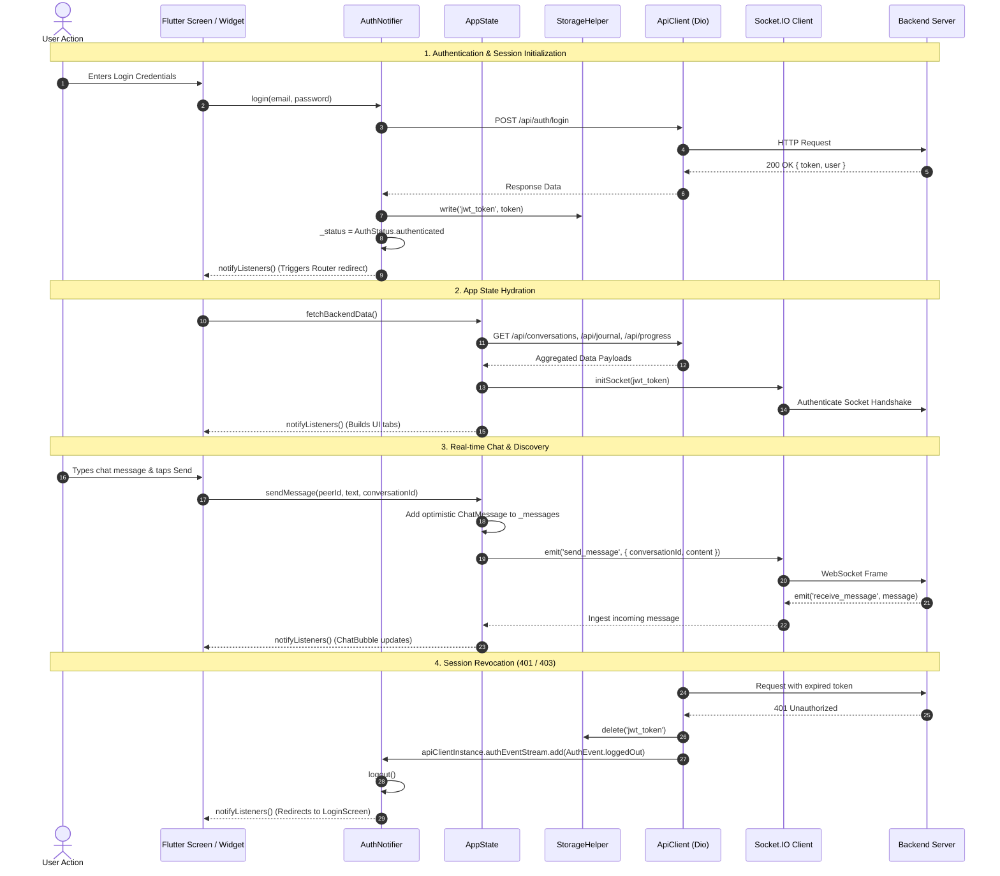

# State Management Architecture: Wehere

## 1. State Management Approach

The Wehere application utilizes **`Provider` (v6.1.2)** as its primary architectural state management and dependency injection solution, combined with scoped **`StatefulWidget` / `setState`** for localized transient UI state (e.g., text controllers, countdown timers, drag offsets, and animation physics).

### Global Injection Topology
As defined in [main.dart](file:///e:/Websites/Wehere/lib/main.dart#L26-L30), the entire application tree is wrapped in a root `MultiProvider`:

```dart
MultiProvider(
  providers: [
    ChangeNotifierProvider(create: (_) => AuthNotifier()..initializeSession()),
    ChangeNotifierProvider(create: (_) => AppState()),
  ],
  child: MaterialApp(...),
)
```

1. **`AuthNotifier`**: Scoped strictly to authentication state machine transitions, credentials storage, email OTP verification, and onboarding completion.
2. **`AppState`**: A single global application domain controller holding cached models, real-time WebSocket messaging state, discovery swipe cards, journal entries, streaks, XP gamification, and emergency contacts.

---

## 2. Comprehensive State Holders Inventory

### A. `AuthNotifier` ([auth_notifier.dart](file:///e:/Websites/Wehere/lib/state/auth_notifier.dart))

| Stored Property | Type | Default Value | Purpose | Who Reads It? | Who Updates It? |
| :--- | :--- | :--- | :--- | :--- | :--- |
| `_status` | `AuthStatus` | `.initializing` | Tracks session lifecycle: `initializing`, `unauthenticated`, `unverified`, `authenticated`. | [AppRouter](file:///e:/Websites/Wehere/lib/core/routing/app_router.dart), [SplashScreen](file:///e:/Websites/Wehere/lib/screens/splash/splash_screen.dart) | `initializeSession()`, `login()`, `logout()`, `verifyOtp()`, `apiClient.authEventStream` |
| `_userId` | `String?` | `null` | Persistent unique user ID. | [ProfileScreen](file:///e:/Websites/Wehere/lib/screens/profile/profile_screen.dart), [AppState](file:///e:/Websites/Wehere/lib/state/app_state.dart) | `initializeSession()`, `login()`, `verifyOtp()`, `logout()` |
| `_registeredName` | `String` | `'User'` | Interim name used during signup/OTP handoffs. | [OtpVerificationScreen](file:///e:/Websites/Wehere/lib/screens/auth/otp_verification_screen.dart) | `register()`, `cancelPendingSignup()` |
| `_registeredEmail` | `String` | `''` | User email address. | [OtpVerificationScreen](file:///e:/Websites/Wehere/lib/screens/auth/otp_verification_screen.dart), [LoginScreen](file:///e:/Websites/Wehere/lib/screens/auth/login_screen.dart) | `initializeSession()`, `login()`, `register()`, `verifyOtp()` |
| `_hasSeenWalkthrough` | `bool` | `false` | Whether user has seen 4-slide intro. | [SplashScreen](file:///e:/Websites/Wehere/lib/screens/splash/splash_screen.dart) | `initializeSession()`, `markWalkthroughSeen()` |
| `_hasCompletedOnboarding` | `bool` | `false` | Gatekeeper flag for onboarding wizard. | [AppRouter._buildProtectedRoute](file:///e:/Websites/Wehere/lib/core/routing/app_router.dart#L163), [SplashScreen](file:///e:/Websites/Wehere/lib/screens/splash/splash_screen.dart) | `initializeSession()`, `login()`, `completeOnboarding()` |
| `_authError` | `String?` | `null` | Error message string from auth API failures. | [LoginScreen](file:///e:/Websites/Wehere/lib/screens/auth/login_screen.dart), [SignUpScreen](file:///e:/Websites/Wehere/lib/screens/auth/signup_screen.dart) | `login()`, `register()`, `verifyOtp()` |
| `_isLoading` | `bool` | `false` | Global auth operation loading spinner flag. | [LoginScreen](file:///e:/Websites/Wehere/lib/screens/auth/login_screen.dart), [SignUpScreen](file:///e:/Websites/Wehere/lib/screens/auth/signup_screen.dart) | `login()`, `register()`, `verifyOtp()`, `completeOnboarding()` |
| `_pendingSignupToken` | `String?` | `null` | Temporary JWT token issued before email OTP verification. | [OtpVerificationScreen](file:///e:/Websites/Wehere/lib/screens/auth/otp_verification_screen.dart) | `register()`, `verifyOtp()`, `cancelPendingSignup()` |

---

### B. `AppState` ([app_state.dart](file:///e:/Websites/Wehere/lib/state/app_state.dart))

| Stored Property | Type | Purpose | Who Reads It? | Who Updates It? |
| :--- | :--- | :--- | :--- | :--- |
| `_currentUser` | `UserProfile` | Active user profile (name, bio, photos, age, location, preferences). | [HomeScreen](file:///e:/Websites/Wehere/lib/screens/home/home_screen.dart), [ProfileScreen](file:///e:/Websites/Wehere/lib/screens/profile/profile_screen.dart), [EditProfileScreen](file:///e:/Websites/Wehere/lib/screens/profile/edit_profile_screen.dart) | `fetchCurrentUser()`, `updateUserProfile()`, `_loadPersistedUserData()` |
| `availableInterests` / `Feelings` / `SupportTypes` | `List<ConfigOption>` | Dynamic chips fetched from backend admin config. | [OnboardingFlowScreen](file:///e:/Websites/Wehere/lib/screens/onboarding/onboarding_flow_screen.dart), [EditProfileScreen](file:///e:/Websites/Wehere/lib/screens/profile/edit_profile_screen.dart) | `fetchConfigOptions()` |
| `_cards` / `_swipedHistory` | `List<MatchCard>` | Discovery card stack and undo history. | [DiscoverSwipeScreen](file:///e:/Websites/Wehere/lib/screens/discover/discover_swipe_screen.dart) | `fetchBackendData()`, `swipeLeft()`, `swipeRight()`, `rewindLastSwipe()` |
| `_activeDiscoveryFilter` | `String` | Card deck filter ('For You', 'New', 'Active Now', 'Near You'). | [DiscoverSwipeScreen](file:///e:/Websites/Wehere/lib/screens/discover/discover_swipe_screen.dart) | `setDiscoveryFilter()` |
| `_matchedUsers` | `List<UserProfile>` | List of peer profiles with active mutual matches. | [ChatListScreen](file:///e:/Websites/Wehere/lib/screens/chat/chat_list_screen.dart), [ChatConversationScreen](file:///e:/Websites/Wehere/lib/screens/chat/chat_conversation_screen.dart) | `fetchBackendData()`, `swipeRight()`, `reportAndBlockPeer()` |
| `_lastMatch` | `MatchCard?` | Holds last match data for celebration popup. | [DiscoverSwipeScreen](file:///e:/Websites/Wehere/lib/screens/discover/discover_swipe_screen.dart) | `swipeRight()`, `clearLastMatch()` |
| `_currentTabIndex` | `int` | Active bottom navigation bar index (0 to 4). | [MainNavigationShell](file:///e:/Websites/Wehere/lib/screens/main_navigation_shell.dart) | `setTabIndex()` |
| `_todayMood` | `String?` | Selected mood for current calendar date. | [HomeScreen](file:///e:/Websites/Wehere/lib/screens/home/home_screen.dart) | `checkInMood()`, `fetchBackendData()` |
| `_dayStreak` / `_weeklyProgress`| `int` | Daily streak count and 7-day progress. | [HomeScreen](file:///e:/Websites/Wehere/lib/screens/home/home_screen.dart), [ProfileScreen](file:///e:/Websites/Wehere/lib/screens/profile/profile_screen.dart) | `fetchBackendData()`, `checkInMood()` |
| `_unreadMessages` | `int` | Total unread message badge count. | [MainNavigationShell](file:///e:/Websites/Wehere/lib/screens/main_navigation_shell.dart) (Tab 3 badge) | `fetchBackendData()`, socket `receive_message` |
| `_currentXp` / `_targetXp` / `_userLevel` | `int` | Gamification progression and badge level. | [ProgressDashboardScreen](file:///e:/Websites/Wehere/lib/screens/progress/progress_dashboard_screen.dart) | `fetchBackendData()`, actions rewarding XP (+10, +15, +20) |
| `isSubscribed` | `bool` | Wehere Plus premium entitlement flag. | [MockBannerAd](file:///e:/Websites/Wehere/lib/widgets/mock_banner_ad.dart), [DiscoverSwipeScreen](file:///e:/Websites/Wehere/lib/screens/discover/discover_swipe_screen.dart) | `setSubscribed()` |
| `_swipeCount` | `int` | Counter tracking swipes for free tier limit (max 5). | [DiscoverSwipeScreen](file:///e:/Websites/Wehere/lib/screens/discover/discover_swipe_screen.dart) | `incrementSwipe()`, `swipeRight()` |
| `_messages` | `Map<String, List<ChatMessage>>` | Dictionary mapping `peerId` to chronologically ordered messages. | [ChatConversationScreen](file:///e:/Websites/Wehere/lib/screens/chat/chat_conversation_screen.dart) | `fetchBackendData()`, `sendMessage()`, socket `receive_message` |
| `_conversationIds` | `Map<String, String>` | Dictionary mapping `peerId` to server `conversationId`. | [ChatConversationScreen](file:///e:/Websites/Wehere/lib/screens/chat/chat_conversation_screen.dart) | `fetchBackendData()`, `swipeRight()` |
| `_typingStatus` | `Map<String, bool>` | Peer live typing indicator. | [ChatConversationScreen](file:///e:/Websites/Wehere/lib/screens/chat/chat_conversation_screen.dart) | Socket `user_typing` |
| `_journalEntries` | `List<JournalEntry>` | Cached user journal entries. | [JournalHomeScreen](file:///e:/Websites/Wehere/lib/screens/journal/journal_home_screen.dart), [ProfileScreen](file:///e:/Websites/Wehere/lib/screens/profile/profile_screen.dart) | `fetchBackendData()`, `addJournalEntry()`, `updateJournalEntry()`, `deleteJournalEntry()` |
| `_communityPosts` | `List<CommunityPost>` | Public community feed posts. | [CommunityScreen](file:///e:/Websites/Wehere/lib/screens/community/community_screen.dart) | `fetchBackendData()`, `addCommunityPost()`, `togglePostLike()` |
| `_goals` | `List<WellnessGoal>` | Personal self-care goals and checkboxes. | [ProgressDashboardScreen](file:///e:/Websites/Wehere/lib/screens/progress/progress_dashboard_screen.dart) | `fetchBackendData()`, `toggleGoal()`, `addGoal()` |
| `_emergencyContacts` | `List<EmergencyContact>` | Trusted emergency SOS contact list. | [SosHelpScreen](file:///e:/Websites/Wehere/lib/screens/sos/sos_help_screen.dart) | `fetchBackendData()`, `addEmergencyContact()`, `removeEmergencyContact()` |
| `_notifications` | `List<UserNotification>` | In-app notification alerts list. | [ProgressDashboardScreen](file:///e:/Websites/Wehere/lib/screens/progress/progress_dashboard_screen.dart) | `fetchBackendData()`, `markNotificationsRead()` |
| `_milestones` | `List<Milestone>` | Gamification badges list and unlock state. | [ProgressDashboardScreen](file:///e:/Websites/Wehere/lib/screens/progress/progress_dashboard_screen.dart) | `_loadPersistedMilestones()`, `checkMilestones()` |

---

## 3. Mermaid Diagram: Reactive State Architecture



---

## 4. State Architecture Strengths & Anti-Patterns

### Strengths
1. **Centralized Auth Guards**: Routing checks `context.watch<AuthNotifier>()` directly, ensuring an unauthenticated user cannot navigate into deep screens even via manual route pushing.
2. **Optimistic Updates**: Swipes and chat messages appear immediately on screen before network confirmations resolve, providing a responsive 60fps native feel.
3. **Decoupled Interceptor Bus**: The `StreamController<AuthEvent>` inside [api_client.dart](file:///e:/Websites/Wehere/lib/core/network/api_client.dart#L10) enables network errors (401/403) to trigger app-wide logouts without tightly coupling the Dio HTTP client to Flutter UI contexts.

### Architectural Risks & Improvements
1. **Monolithic `AppState` (`God Object`)**: At ~1,800 lines, `AppState` violates Single Responsibility Principle. A mutation to any domain (e.g. toggling a goal checkmark) triggers rebuilds across all widgets watching `AppState` unless scoped with `Selector`.
2. **Missing Granular Selectors**: Many widgets call `context.watch<AppState>()` instead of `context.select<AppState, T>()`. For example, in [main_navigation_shell.dart](file:///e:/Websites/Wehere/lib/screens/main_navigation_shell.dart#L41), reading the whole `AppState` causes the entire shell to rebuild whenever any background message arrives or mood check-in occurs.
3. **Recommended Refactoring**: Split `AppState` into 4 focused domain notifiers:
   - `DiscoveryNotifier` (cards, swiping, rewinds, filters)
   - `ChatNotifier` (socket lifecycle, conversations, typing status, voice notes)
   - `JournalNotifier` (journal CRUD, date filtering)
   - `WellnessNotifier` (moods, streaks, XP, goals, SOS contacts)
